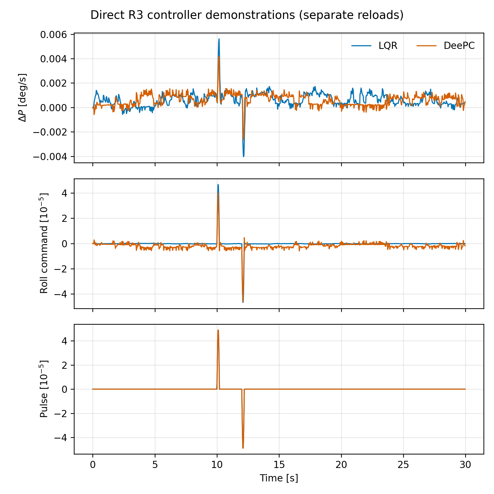
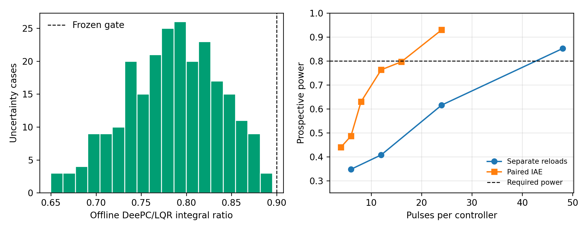

# From Offline Optimality to Real-Time Simulation Flight: Delay-Aware LQR and Constrained DeePC for an EHEKATL Blended-Wing-Body Aircraft

**Authors:** [Author names and affiliations]

## Abstract

Nominal optimal-control results can degrade substantially when transferred to a
high-fidelity flight simulator containing unmodeled actuator routing, hidden
augmentation, input delay, constraints, and operating-point variability. This
paper documents the development of linear-quadratic regulation (LQR) and
regularized constrained data-enabled predictive control (DeePC) for roll-rate
regulation of the EHEKATL blended-wing-body aircraft in X-Plane 12. A
recovery-capable backstepping controller was retained as the stabilizing
baseline and permanent fallback. Stabilized multisine experiments exposed a
measured 35-Hz cascade from commanded yoke input through total control and
distributed surface motion to body roll rate. A delay-aware discrete LQR and a
P-only DeePC controller were then frozen under identical command and slew
limits. The LQR integrated safely, but its matched-flight integral metric was
0.8888 of the backstepping result, corresponding to an 11.1% improvement and
failing the predeclared 30% target. DeePC passed 243/243 frozen-model
uncertainty cases with worst and median DeePC-to-LQR integral ratios of 0.8953
and 0.7881. In direct X-Plane demonstrations, both controllers ran at 35 Hz,
remained within constraints, produced measurable recovered responses, and
restored actuator ownership without safety events. DeePC's maximum observed
optimization time was 7.90 ms against a 28.57-ms control period. However,
prospective power analysis showed that a defensible superiority experiment
would require 48 pulses per controller for separate reloads, or 24 paired
pulses with an unvalidated switching protocol. The results therefore support
safe real-time implementation and expose the offline-to-simulation gap, but do
not establish DeePC superiority. The study demonstrates how failed performance
and power gates can provide useful, reproducible control-engineering evidence.

**Keywords:** blended-wing body, LQR, DeePC, X-Plane, system identification,
real-time control, flight simulation, safety supervision

## 1. Introduction

Linear-quadratic control is attractive for aircraft regulation because it
provides a transparent state-feedback law and an explicit state-versus-control
tradeoff [1]. Its conclusions nevertheless depend on the fidelity of the model,
state definition, actuator representation, delay model, and operating point.
Data-enabled predictive control offers a complementary approach: rather than
first reducing measured behavior to a low-order parametric plant, DeePC uses
input-output trajectories to predict and optimize future behavior subject to
constraints [2,3]. Whether this advantage survives real-time implementation is an
experimental question.

The EHEKATL aircraft is a scale blended-wing-body model represented in X-Plane
12. Initial thesis-derived LTI studies produced stable LQR behavior offline,
but direct transfer to X-Plane was unsuccessful. Historical fixed-gain flights
reached 53.0 deg absolute pitch and 111.9 deg absolute roll in one run, while a
second run repeatedly activated divergence guards. These failures motivated a
stage-gated redevelopment process based on measured actuator realization,
independent training and validation data, immutable performance thresholds, and
a recovery-capable backstepping baseline.

This paper makes four bounded contributions. First, it documents the
implementation gap between nominal LQR analysis and the realized X-Plane
control path. Second, it presents a stabilized identification procedure and a
directly discrete 35-Hz roll cascade. Third, it implements constrained LQR and
DeePC controllers behind a common safety, fallback, and actuator-restoration
contract. Fourth, it reports both successful real-time integration and failed
performance/power gates without retrospectively weakening the criteria. The
experiments are real-time closed-loop simulation flights; they are not
physical-aircraft flight tests.

## 2. Aircraft, simulator, and operating condition

The test article was the EHEKATL BWB G33 scale aircraft in X-Plane 12.4.3-r2,
interfaced through the NASA XPlaneConnect architecture [5].
The frozen local operating condition, denoted R3, was approximately 1700 m
altitude, 39 kt indicated airspeed, 240 Pa dynamic pressure, cockpit throttle
0.02353, 1.3 deg pitch, near-zero roll, and low body rates. Manual/Clear weather,
no declared failures, enabled X-Plane artificial stability, disabled
autopilot/autothrottle, live simulation speed, and replay off were required.

The common manipulated variable was trim-relative yoke-roll perturbation. Body
roll rate P was the primary regulated output. Roll angle, total roll-control
ratio, distributed aileron deflection, moments, simulator state, override
ownership, and timing were retained as audit channels. Both optimized
controllers ran at 35 Hz with command magnitude limited to 0.0002 normalized
units and slew limited to 0.00005 per sample. The original backstepping law was
updated at its validated 10-Hz rate and held between updates when used as the
fallback.

## 3. Control-path diagnosis and identification

Early experiments showed that a transmitted XPlaneConnect CTRL packet did not
necessarily equal the realized actuator input. When the simulator was paused
or in replay, writable yoke values could change without advancing surfaces or
aircraft dynamics. Even in live simulation, physical joystick input could
overwrite nonpersistent commands between controller updates. Persistent
per-axis ownership and direct yoke writes were therefore required.

Taking ownership exposed an additional trim problem. The original controller
implicitly relied on a physical pitch input near 0.149 normalized units. A
first owned-axis handoff removed this contribution and produced a pitch-rate
transient of approximately -13.85 deg/s. Subsequent tests captured the realized
trim before ownership and applied controller outputs as trim-relative
perturbations. Artificial stability remained active and altered the mapping
between yoke command and total control; consequently, measured total control,
not sent command alone, was used for plant identification.

Stabilized multisine experiments were superimposed on backstepping rather than
replacing it. Two training and two held-out validation runs were collected for
each of roll and pitch. All eight datasets passed completeness, realization,
spectral-richness, safety, and restoration gates. A 10-Hz local angle/rate model
identified a three-sample input delay but retained colored residuals. Higher-rate
testing subsequently isolated the measured cascade

\[
u_{y,k} \rightarrow u_{t,k} \rightarrow \delta_{a,k} \rightarrow P_k,
\]

where commanded yoke perturbation maps dynamically to total roll control,
total control maps almost statically to distributed aileron motion, and surface
motion maps dynamically to roll rate. Temporal held-out validation supported a
directly discrete 35-Hz cascade, while continuous-time pole interpretations
were rejected because fitted time constants were at or below the sampling
interval.

## 4. Delay-aware LQR

The frozen roll-rate LQR state was

\[
x_k = [\Delta P_k,\;\Delta u_{t,k},\;\Delta u_{y,k-1}]^T,
\]

with the identified dynamics

\[
x_{k+1}=Ax_k+Bu_k.
\]

The discrete matrices were

\[
A=\begin{bmatrix}
0.40856&3.55738&37.94551\\
0&0.05609&0.59835\\
0&0&0
\end{bmatrix},\qquad
B=\begin{bmatrix}23.90120\\0.37689\\1\end{bmatrix}.
\]

The input minimized the infinite-horizon quadratic cost

\[
J=\sum_{k=0}^{\infty}(x_k^TQx_k+u_k^TRu_k),
\]

subject at runtime to the common command and slew limits. The resulting gain
was

\[
K=[0.0002944,\;0.0027424,\;0.0292528].
\]

The nominal closed-loop spectral radius was 0.3684. Across 243 coefficient
combinations, the worst spectral radius was 0.4936 with no unstable cases.
These results establish robustness of the frozen measured-cascade model, not
global stability of the X-Plane aircraft.

## 5. Regularized constrained DeePC

The selected DeePC used one input (trim-relative yoke-roll perturbation) and one
output (roll-rate perturbation). Attempts to predict P, roll angle, and total
roll control jointly failed the reconstruction gate; the final claim is
therefore explicitly P-only. With Hankel matrices constructed from the frozen
design trajectory following the behavioral trajectory parameterization [2,4],
each control update solved a regularized finite-horizon
problem of the form

\[
\min_g \; \|y_f\|_{Q_y}^2+\|u_f\|_{R_u}^2+
\|\Delta u_f\|_{R_{\Delta u}}^2+\lambda_g\|g\|_2^2,
\]

subject to past input/output consistency, future behavioral constraints, and
hard command/slew bounds. The frozen configuration used five past samples,
five prediction samples, \(\lambda_g=10\), \(Q_y=1\), \(R_u=0.01\), and
\(R_{\Delta u}=0.02\). Constant optimizer matrices were precomputed, reducing
online runtime without changing commands; packaged-versus-design command error
was exactly zero.

The controller contained a permanent fallback latch. Nonfinite inputs,
optimizer nonconvergence, deadline violation, simulator-state violation, or
safety-envelope violation permanently transferred selection to bounded
backstepping for the remainder of the run. Automatic DeePC re-engagement was
not permitted.

## 6. Experimental protocol and metrics

Every engaged run first evaluated altitude, airspeed, pitch, roll, body rates,
artificial-stability state, override ownership, pause, simulation speed, and
replay mode. A failed start gate sent no control. After a passing gate, roll and
pitch axes were owned explicitly. Pitch remained stabilized by the original
backstepping law, while the tested controller supplied the roll perturbation.
Captured yoke values were restored in a `finally` path and verified after the
run.

The primary performance measure was time-integrated absolute roll-rate
deviation. Secondary measures included peak and final-window roll-rate
deviation, control energy, command and slew utilization, computation time,
deadline misses, fallback events, and restoration error. Performance thresholds
and dataset roles were frozen before confirmation data were opened. A safe run
was treated as integration evidence, not automatically as a performance pass.

## 7. Results

### 7.1 LQR matched-performance result

The measured-cascade LQR passed its integration and safety prerequisites. In
the frozen matched backstepping/LQR flight pair, the final integral ratio was
0.888807, or an 11.1% reduction relative to backstepping. The predeclared gate
required a ratio no greater than 0.70. The LQR performance claim therefore
failed. The ratio worsened as the quiet tail was accumulated, indicating that
reload-specific background motion dominated the small disturbance response.

### 7.2 DeePC offline robustness and integration

The final DeePC candidate converged in all 243 frozen-model uncertainty cases.
The worst and median DeePC/LQR integral ratios were 0.895344 and 0.788056, and
the worst peak ratio was 0.928154. Maximum command and base slew were
4.39e-5 and 9.97e-6, respectively, within the common constraints. A guarded
design pilot passed all integration gates and was excluded from confirmation.

### 7.3 Direct demonstrations

Table 1 reports the two user-requested direct demonstrations. Each began after
a fresh R3 reload; consequently, the values are descriptive and are not a
matched comparison.

| Metric | DeePC | LQR |
|---|---:|---:|
| Samples | 1050 | 1050 |
| Effective frequency [Hz] | 35.0014 | 35.0040 |
| Maximum gap [ms] | 50.09 | 42.23 |
| Integral absolute delta-P [deg] | 0.01972 | 0.02025 |
| RMS delta-P [deg/s] | 0.000796 | 0.000863 |
| Peak absolute delta-P [deg/s] | 0.004163 | 0.005622 |
| Final-5-s maximum absolute delta-P [deg/s] | 0.001311 | 0.001496 |
| Peak command | 4.609e-5 | 4.670e-5 |
| Maximum slew | 2.126e-5 | 2.171e-5 |
| Fallback/safety event | none | none |
| Verified restoration | pass | pass |

DeePC median, 95th-percentile, and maximum optimization times were 4.02, 5.36,
and 7.90 ms, respectively, below the 28.57-ms sample period. Both controller
runtimes reproduced their frozen offline behavior exactly. The slightly smaller
DeePC response metrics cannot be interpreted causally because the initial
reloads and background trajectories were not matched.

### 7.4 Prospective power

Prospective moving-block bootstrap analyses quantified the cost of an
independent superiority claim. A separate-reload design first exceeded 0.80
power at 48 pulses per controller, requiring at least 149 s per controller. A
paired mean per-pulse IAE design achieved power 0.7967 at 16 pairs, which failed
the unchanged 0.80 gate; it first qualified at 24 pairs and at least 152 s.
That design also required controller switching and history handoffs not yet
validated in flight. The benchmark was therefore rejected before collection.

## 8. Discussion

The experiments show why offline optimality and online performance should be
treated separately. The LQR was stable and robust over its identified model,
yet its matched improvement was small in X-Plane. The dominant complications
were not numerical Riccati-solver limitations: they were control ownership,
hidden trim, artificial-stability dynamics, a dynamic commanded-to-realized
input path, local model validity, and reload-specific background motion.

DeePC reduced dependence on an explicit low-order state realization and passed
the frozen offline robustness gate. It also met the real-time computational
budget comfortably. Nevertheless, using measured data does not eliminate
distribution shift. The selected controller predicts only P, its design data
come from a local R3 trajectory, and the effect expected over LQR was too small
relative to observed variability for an economical confirmation campaign.

The negative gates are an engineering result. Relaxing the 30% LQR target after
observing an 11.1% improvement, rounding 0.7967 power to 0.80, or presenting
separate-reload demonstrations as a matched comparison would each overstate the
evidence. Preserving these failures yields a reproducible account of what the
controllers do reliably: bounded local roll-rate regulation with verified
real-time execution, fallback readiness, and restoration.

## 9. Limitations

The conclusions apply only near R3 and do not establish transfer to other
airspeeds, dynamic pressures, mass properties, weather conditions, or failure
states. Artificial stability was enabled and forms part of the tested plant.
The work validates roll-rate behavior, not a complete attitude loop, combined
longitudinal/lateral operation, or large-disturbance recovery. DeePC is P-only.
The direct demonstrations are single, unmatched runs. Finally, X-Plane is a
high-fidelity simulation environment, not physical flight hardware; network,
sensor, actuator, and aerodynamic effects on a real aircraft may differ.

## 10. Conclusions

A delay-aware measured-cascade LQR and a regularized constrained DeePC were
implemented successfully for the EHEKATL BWB in real-time X-Plane flight. Both
direct demonstrations met timing, command, slew, safety, exact-replay, fallback,
and actuator-restoration requirements. DeePC optimization remained well within
the 35-Hz deadline. However, LQR failed its predeclared 30% matched-improvement
gate, and a powered DeePC-versus-LQR superiority experiment was impractical
under the available local protocol. The appropriate conclusion is therefore
not that one controller universally outperforms the other, but that safe
implementation is achievable while predicted performance differences can be
overwhelmed by the realized control path and operating variability. Future work
should prioritize multi-regime data, state/augmentation measurements,
gain-scheduled or multi-dataset formulations, and a prospectively powered
common benchmark before extending to attitude control.

## Data and reproducibility statement

Every paper-facing dataset is listed with its role and SHA256 hash in
`paper/DATASET_REGISTRY.csv`. Raw logs are retained under `logs/`, frozen
numerical artifacts under `configs/`, and controller/analysis code under
`lqr/`, `deepc/`, and `scripts/`. Paper tables and figures are regenerated by
`paper/generate_paper_results.py`. Design, demonstration, and held-out evidence
are kept distinct. No physical-aircraft data are claimed.

## References

[1] R. E. Kalman, “Contributions to the Theory of Optimal Control,” *Boletín de
la Sociedad Matemática Mexicana*, vol. 5, pp. 102–119, 1960.

[2] J. Coulson, J. Lygeros, and F. Dörfler, “Data-Enabled Predictive Control:
In the Shallows of the DeePC,” in *Proceedings of the European Control
Conference*, pp. 307–312, 2019. doi:10.23919/ECC.2019.8795639.

[3] J. Coulson, J. Lygeros, and F. Dörfler, “Distributionally Robust Chance
Constrained Data-Enabled Predictive Control,” *IEEE Transactions on Automatic
Control*, vol. 67, no. 7, pp. 3289–3304, 2022.
doi:10.1109/TAC.2021.3097706.

[4] J. C. Willems, P. Rapisarda, I. Markovsky, and B. L. M. De Moor, “A Note on
Persistency of Excitation,” *Systems & Control Letters*, vol. 54, no. 4,
pp. 325–329, 2005. doi:10.1016/j.sysconle.2004.09.003.

[5] NASA Ames Research Center, “X-Plane Communication Toolbox (XPC),” NASA
Software Catalog, reference ARC-17185-1, accessed 2026-08-10.
