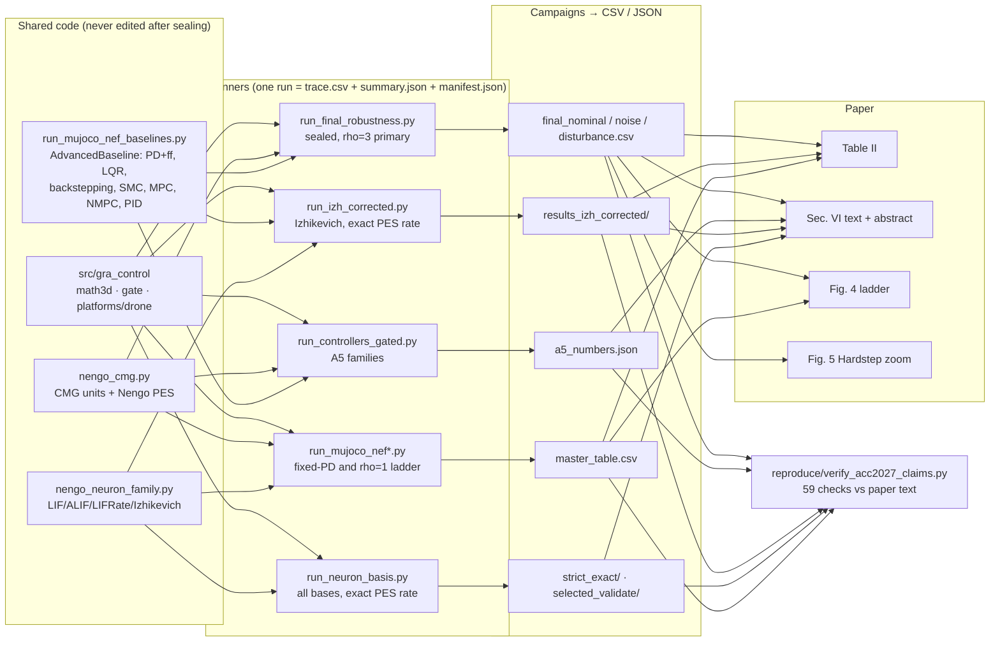

# ACC 2027 — Reproduction and claim-tracking schematic

*Online PES Decoder Learning in Neuromorphic Residual UAV Attitude Control* (Contreras, Sandoval, Garcia Carrillo).
Every number in the paper, the script that produces it, the file it lands in, and one command to check it.

**Status (2026-10-02, manuscript v31):** `reproduce/verify_acc2027_claims.py` recomputes 73 paper numbers from the raw
run outputs; **73/73 match**. Claims 60–73 (added for v31) cover the reduced-CMG ablation, gate latching, the G and χ
ablations and the constant-basis definition, from `experiments/cmg_mechanism_controls_2026-10-01`. Manuscript and change
log: `paper/v31_2026-10-02_reduced_cmg/`.

*Earlier status (2026-09-30, manuscript version of Sept. 30):* 59/59 match (the 8 mismatches found earlier, Section 7,
were corrected in the paper).

**Equation-to-code companion:** `paper/companion_2026-09-30/ACC2027_equation_code_companion.pdf` — every equation (1)–(30)
and both propositions with derivation, citations, the exact implementing code lines, and an audit appendix (source/model
hashes vs. the published run manifests, 9/9 identical; the 59 recomputed claims). Rebuild with
`paper/companion_2026-09-30/tools/build_companion_tables.py`, then pdflatex/bibtex.

---

## 1. Pipeline at a glance



### Exact location of every box (root `C:\Research\papers\ACC2027_Gate_Residual_Control\`)

| Box | Path |
|---|---|
| `src/gra_control` | `src\gra_control\math3d.py`, `src\gra_control\gate.py`, `src\gra_control\platforms\drone.py` |
| `run_mujoco_nef_baselines.py` (AdvancedBaseline) | `experiments\nengo_nef_replication_2026-08-29\run_mujoco_nef_baselines.py` |
| `nengo_cmg.py` | `experiments\nengo_nef_replication_2026-08-29\nengo_cmg.py` |
| `nengo_neuron_family.py` | `experiments\nengo_nef_replication_2026-08-29\nengo_neuron_family.py` |
| `run_final_robustness.py` | `experiments\final_robustness_gating_2026-09-20\run_final_robustness.py` |
| `run_izh_corrected.py` (+ adapter) | `experiments\final_robustness_gating_2026-09-20\run_izh_corrected.py`, `...\izh_adapter_corrected.py` |
| `run_controllers_gated.py` | `experiments\final_robustness_gating_2026-09-20\run_controllers_gated.py` |
| `run_mujoco_nef*.py` | `experiments\nengo_nef_replication_2026-08-29\run_mujoco_nef.py`, `...\run_mujoco_nef_corrected.py` |
| `run_neuron_basis.py` (+ adapter) | `experiments\neuron_basis_decisive_2026-09-24\run_neuron_basis.py`, `...\family_basis_adapter.py` |
| `final_nominal / noise / disturbance.csv` | `experiments\final_robustness_gating_2026-09-20\results\final_nominal.csv` (and `final_noise.csv`, `final_disturbance.csv`) |
| `results_izh_corrected/` | `experiments\final_robustness_gating_2026-09-20\results_izh_corrected\table2_full_2026-09-29\` |
| `a5_numbers.json` | `experiments\final_robustness_gating_2026-09-20\results\a5_numbers.json` |
| `master_table.csv` | `experiments\baseline_restatement_2026-09-16\master_table.csv` |
| `strict_exact/ · selected_validate/` | `experiments\neuron_basis_decisive_2026-09-24\results\strict_exact\`, `...\results\selected_validate\` |
| Table II | Overleaf `tables/table_all_restructured.tex` (local copy `paper\v15_2026-09-29_corrected\tables\table_all_restructured.tex`) |
| Fig. 4 ladder | `experiments\final_robustness_gating_2026-09-20\figures_out\ladder\x2_hard45_ladder_C.pdf` |
| Fig. 5 Hardstep zoom | `experiments\final_robustness_gating_2026-09-20\figures_out\x2_hardstep_gate_zoom.pdf` |
| Verifier | `reproduce\verify_acc2027_claims.py` |

Paths below are relative to `experiments/`. Abbreviations: **FR** = `final_robustness_gating_2026-09-20`,
**NB** = `neuron_basis_decisive_2026-09-24`, **NN** = `nengo_nef_replication_2026-08-29`,
**BR** = `baseline_restatement_2026-09-16`.

---

## 2. Setup

```powershell
$root = 'C:\Research\papers\ACC2027_Gate_Residual_Control'
$py   = "$root\.venv\Scripts\python.exe"      # Python 3.13, NumPy 2.5.2, MuJoCo 3.12.0, Nengo 4.1.0
```

Windows PowerShell 5.1: chain commands with `;`, not `&&`. All campaigns cap at 4 parallel workers except the
neuron-basis study (10); memory, not CPU, is the limit.

## 2b. Watch any mission live (MuJoCo viewer)

`reproduce\run_mission_viewer.py` runs the paper's sealed runner (`run_final_robustness.py`, imported unchanged) and
refreshes a MuJoCo passive viewer after each physics step. The viewer is read-only, so a run reproduces the published
number exactly (verified bit-for-bit, relative difference 0.0). Thin coloured axes show the *reference* attitude, the
vehicle shows its body frame; on-screen text gives time, current and running-mean error. At the end the 45-s mean is
compared with the published value and printed as MATCH/DIFFERS. Do not drag the vehicle with the mouse if you want the
published number (Ctrl+drag perturbs the plant).

```powershell
cd C:\Research\papers\ACC2027_Gate_Residual_Control
# optional: activate the environment (otherwise call .venv\Scripts\python.exe directly)
.\.venv\Scripts\Activate.ps1          # if blocked: Set-ExecutionPolicy -Scope Process Bypass

python reproduce\run_mission_viewer.py --platform x2  --mission hard45 --arm cmg     # X2, + gated CMG-PES (beta .5)
python reproduce\run_mission_viewer.py --platform x2  --mission hard45 --arm pdff    # X2, PD+ff baseline alone
python reproduce\run_mission_viewer.py --platform cf2 --mission hardstep --arm cmg   # CF2, beta .2, gate active
python reproduce\run_mission_viewer.py --platform cf2 --mission hover --arm cmg --disturbance x1     # bursts (Sec. VI-E)
python reproduce\run_mission_viewer.py --platform x2  --mission full3 --arm cmg --noise realistic --seed 3
```

Options: `--mission roll|full3|hard45|hardstep|yaw360|hover`, `--arm pdff|cmg`, `--noise none|moderate|realistic`,
`--seed 1..10`, `--disturbance x0.5|x1|x2` (hover), `--realtime 1` (wall clock; `2` = twice as fast, `0` = as fast as
possible), `--duration 45` (shorter = preview, not comparable), `--no-viewer`, `--no-hold`. Outputs go to
`reproduce\viewer_runs\`, never over the published results. The same through PowerShell, or all 20 nominal cells headless:

```powershell
powershell -ExecutionPolicy Bypass -File reproduce\launch_mission.ps1 -Platform x2 -Mission hard45 -Arm cmg
powershell -ExecutionPolicy Bypass -File reproduce\launch_mission.ps1 -AllNominal
```

## 3. Fast path — check every number without simulating (seconds)

```powershell
& $py "$root\reproduce\verify_acc2027_claims.py"
```

Writes `reproduce/claims_check.md` (one row per claim: paper value, recomputed value, source file) and
`claims_check.csv`. Exit code 1 while any mismatch remains.

---

## 4. Claim → code map

`#` = row in `claims_check.md`. "Run" = the script that produced the raw runs; "Build" = the script that turns runs
into the number.

### Abstract and Sec. VI-B — primary result (PD+ff, ρ = 3, gated; β = .5 X2, .2 CF2)

| Claim in paper | Value | Run | Build | Output | # |
|---|---|---|---|---|---|
| Geometric-mean reduction | 37.3 % X2, 22.4 % CF2 | FR/`run_campaign.py --campaign nominal`, FR/`run_campaign_a2.py` (CF2 β = .2) | FR/`build_final_csv.py` | FR/`results/final_nominal.csv` | 1–4 |
| Full3 / Hard45 | 12–14 % X2, 5–7 % CF2 | same | same | same | 7–8 |
| CF2 ungated needs β = .05 → 6.5 % | 6.5 % | same | same | same | 5 |
| Table II primary block (all cells) | — | same | FR/`make_table2.py` | `paper/.../tables/table_all_restructured.tex` | 1–8 |
| β selection rule, 2 dev + 13 held-out seeds | β = .2 CF2 | FR/`run_campaign_a2.py dev`, `confirm` | FR/`analyze_a2_select.py`, `analyze_a2_confirm.py` | FR/`results/results_a2_*.csv` | — |

### Table II middle and lower blocks — baseline ladder

| Claim | Value | Run | Build | Output | # |
|---|---|---|---|---|---|
| ρ = 1 ladder geo | 57.8 % / 57.6 % | NN/`select_rate_ff.py` (PD+ff ρ = 1 and CMG on it) | BR/`build_restatement.py` | BR/`master_table.csv` | 9–10 |
| Fixed-PD geo, range 17.3–60.6 % | 44.5 % / 44.2 % | NN/`run_campaign.py` (matched 45 s) | BR/`build_restatement.py` | BR/`master_table.csv` | 11–13 |
| Fixed-decoder row | 4.6 % / 3.1 % | NN/`run_neuron_family_campaign.py` (cmg-fixed arm) | BR/`make_merged_table.py` | BR/`tex_table_all.tex` | traced |
| ρ sweep, optimum at ρ = 3, CF2 rotor-limited past ≈ 4 | — | NN/`sweep_baselines_2026_09_10.py` (tune mode) | BR/`build_restatement.py` | BR/`bandwidth_sweep.csv`, `fig2_bandwidth_sweep.pdf` | traced |

### Sec. VI-B — portability across control families (Amendment A5)

| Family | X2 / CF2 | Run | Build | Output | # |
|---|---|---|---|---|---|
| LQR, SMC, MPC, PID+ff | 31.1/22.4, 43.8/26.6, 33.4/22.7, 36.7/22.4 | FR/`run_campaign_a5.py` → `run_controllers_gated.py` | FR/`analyze_a5.py` | FR/`results/a5_numbers.json` | 14–17 |
| NMPC (hold-rate corrected) | 31.9/21.7 | FR/`run_campaign_a5_nmpc_corrected.py` | FR/`analyze_a5.py` | FR/`results/a5_controllers_nmpc_corrected/` | 18 |
| Backstepping | 37.3/22.4 | FR/`run_campaign_a5_backstepping.py` | FR/`analyze_a5.py` | same file | 19 |

Backstepping with model feedforward off is algebraically PD + desired-rate feedforward, so its row equals the primary
result. All 20 cells reproduce `final_nominal.csv` at relative deviation 0.0 (FR/`REPORT_A5_CERTIFICATION_2026-09-24.md` §4).
β = 0 recovery (Prop. 1(iii)) checked for LQR, SMC, MPC, NMPC at 0.0 deviation: FR/`certify_beta0_recovery.py`.

### Sec. VI-C — mechanism ablation

| Claim | Value | Source | # |
|---|---|---|---|
| χ toggle numerically indistinguishable; c_j = 2×10⁻⁹ s⁻¹ at rest; fixed point 0.107 → 0.092 | — | `paper/v13_2026-09-20_robustness/AUDIT_v13_2026-09-20.md` row 3 (`chi_check.py`) | traced |
| Latched PES = first-order filter, corner 9.60 rad/s | 9.60 | `theory_certificate_2026-09-12/compute_local_certificate.py` → `certificate_macros.tex` | 58 |
| Hard45 highest instantaneous frequency 2.1 rad/s, gain 0.977, lag 12.3° | 2.1 | same certificate (`\lagHardGain`, `\lagHardPhase`) | traced |

### Sec. VI-D — neuron-family comparison and alternatives

| Claim | Value in paper | Run | Build / output | # |
|---|---|---|---|---|
| Izhikevich Δ row, ρ = 3 | see §7 | NB/`reproduce_all.ps1` (strict) — also FR/`run_izh_corrected.py` (independent rerun, identical) | NB/`results/strict_exact/<plat>/<mission>/izhikevich/summary.json` | 20–24 |
| Izhikevich effort row (realized residual RMS / bound, arithmetic mean) | 0.063 X2, 0.023 CF2 | FR/`run_izh_corrected.py` | FR/`results_izh_corrected/table2_full_2026-09-29/` | 25–26 |
| CMG effort row | 0.032 / 0.015 | FR primary campaign | FR/`results/final_nominal.csv` | 27–28 |
| Izhikevich rail fraction 0–1.7 % | 0–1.7 % | FR/`run_izh_corrected.py` | trace.csv, method of FR/`rail_fraction_izh.py` | 29 |
| Izhikevich on fixed PD (exact PES rate), CF2 Hardstep diverges | row | NN/`run_fixed_pd_izh_corrected.py` → `run_mujoco_nef_corrected.py --exact-pes-normalization` | NN/`report_fixed_pd_correction.py`; NN/`results/izh_fixed_pd_corrected_2026-09-24/` | 30–31 |
| Static paired / constant basis | see §7 | NB strict campaign | NB/`results/strict_exact/.../{paired-current,constant-one}` | 32–33 |
| Threshold-tuned LIFRate, held out | 15.8 / 11.4 | NB/`select_development.py` → `run_selected_validation.py` | NB/`results/selected_validate/` | 34 |
| LIF/ALIF/LIFRate active ≤ 0.1 % of unit-samples | see §7 | NN/`run_neuron_family_campaign.py` (archived) | NN/`compile_neuron_family_benchmark.py` | 35 |

The PES learning-rate correction (Amendment A4, `eta_N = eta·N/(dt·S²)`) is derived and certified in
FR/`REPORT_NEURON_BASIS_CORRECTION_2026-09-24.md`; the archived `nengo_neuron_family.py` is never edited.

### Sec. VI-E — measurement noise and disturbances

| Claim | Value | Run | Build / output | # |
|---|---|---|---|---|
| 5 moderate + 10 realistic paired seeds | 5 / 10 | FR/`run_campaign.py --campaign noise`, `run_campaign_a2.py noise_rest` | FR/`results/final_noise.csv` | 36 |
| Realistic Full3/Hard45 | 11.3/10.8 X2, 3.9/4.0 CF2 | same | FR/`noise_numbers.py`, `analyze_robustness.py` | 37–38 |
| Roll/Yaw360 change −5.3 … +2.2 %, geo 2.3 / 1.0 % | — | same | same | 39–40 |
| CF2 β = .5 Hardstep diverges 15/15, rotors bound 61–79 % | — | same | FR/`diagnose_cf2_noise.py`, `check_starvation_all_seeds.py` | 41–42 |
| Burst 14.4 % X2 / 5.9 % CF2; 24.0/13.3 and 6.5/4.7 at 0.5×/2× | — | FR/`run_campaign.py --campaign disturbance` | FR/`analyze_robustness.py` → `results/final_disturbance.csv` | 43–48 |
| Quiet phase 14.7 / 19.8 %; X2 0.021° → 0.036° at 0.5× | — | same | same | 49–51 |
| CF2 burst 13.7 % at β = .5 vs 1.5 % at β = .05 | — | same | same | 52 |

### Sec. VI-F — Hardstep and the saturation-aware gate

| Claim | Value | Source | # |
|---|---|---|---|
| X2 ungated −17.0 % → gated −2.0 %; CF2 β = .5 −1.2 %, geo 36.5 % | — | FR/`results/final_nominal.csv` | 53–54 |
| CF2 β = .5 ungated diverges, 136°, rotors bound 92 % | — | same | 55 |
| Gate blocks 20.5 % / 15.5 % of Hardstep samples, ≤ 0.04 % elsewhere | — | same (`gate_blocked_fraction`) | 56 |
| 97–99 % of Hardstep error is slew; braking −0.13°, tail +0.40° | — | FR/`hardstep_profile.py` | traced |
| Twelve gate configurations, −2.1 % … +0.3 %, 79 % blocked at the limit | — | FR/`run_campaign_a1.py`, `run_a1_limit.py` → `analyze_a1.py` | traced |

### Sec. VI-A — implementation

| Claim | Value | Source | # |
|---|---|---|---|
| Nengo vs direct NumPy, worst relative mean error over ten cases | 2.013×10⁻⁶ | NN/`verify_archived_equivalence.py` → `results/compiled/archived_equivalence.csv` | 57 |
| CF2 rotor limit 0.0875 → 0.13125 N (1.5×), X2 13 N unchanged | — | `src/gra_control/platforms/drone.py` + `--actuator-scale 1.5` | traced |
| Validation gate: new runner reproduces archived Table II ρ = 3 block | worst 5.0×10⁻¹⁵ | FR/`run_validation.py` → `results_validation/` | traced |

---

## 5. Figures and tables

| Paper item | Script | Output |
|---|---|---|
| Fig. 1 architecture | TikZ | `paper/.../architectures/architecture_standalone.pdf` |
| Fig. 2 CMG unit | TikZ | `paper/.../architectures/tikz/archB1c.tex` |
| Fig. 3 vehicles | pre-rendered MuJoCo stills (copied by `paper/.../tools/make_v14_zip.py`) | `figures/01_mujoco_missions/fig2_drones_only.pdf` |
| Fig. 4 X2 Hard45 ladder | FR/`make_ladder_figure.py --platforms x2 --missions hard45 --variants C` (asserts every legend mean equals the table value to 1e-4) | FR/`figures_out/ladder/x2_hard45_ladder_C.{pdf,json}` |
| Fig. 5 X2 Hardstep gate zoom | FR/`make_paper_figures.py hardstep_zoom` | FR/`figures_out/x2_hardstep_gate_zoom.pdf` |
| Table I | parameters of `src/gra_control` and the runner defaults | — |
| Table II primary block | FR/`make_table2.py <table.tex>` (prints; `--write` overwrites) | `tables/table_all_restructured.tex` |
| Table II ladder blocks | BR/`make_merged_table.py` | BR/`tex_table_all.tex` |

---

## 6. Full re-simulation (hours)

`reproduce/reproduce_all.ps1 -Stage <name>` runs one stage; every campaign resumes from existing `summary.json` files
and never overwrites archived runs.

| Stage | What it re-runs | Runs | Wall time (4 workers) |
|---|---|---|---|
| `verify` | nothing — recomputes all numbers | 0 | seconds |
| `validation` | FR/`run_validation.py`, must print PASS before anything else | 20 | minutes |
| `primary` | nominal + Hardstep development + A2 CF2 β selection | ~60 | ~10 min |
| `robustness` | noise (450) + disturbance (21) | ~470 | ~100 min |
| `portability` | A5: five families + backstepping + corrected NMPC | ~140 | ~30 min |
| `izhikevich` | the ten ρ = 3 cells, exact PES rate | 10 | ~5 min |
| `neuronbasis` | NB strict + development + held-out validation (10 workers) | 186 | ~1 h |
| `figures` | Fig. 4, Fig. 5, Table II primary block | 0 | seconds |

Ladder (ρ = 1, fixed PD) raw runs live in NN and are rebuilt, not re-simulated, by `build_restatement.py`; the
generating drivers are NN/`run_campaign.py`, `select_rate_ff.py`, `sweep_baselines_2026_09_10.py`
(modes are documented in each docstring).

---

## 7. Items found by the verifier (resolved in the Sept. 30 manuscript)

All eight came from two causes and were corrected in the paper; the verifier now expects the corrected values. One related
statement remains on the archived campaign: the Table II footnote "LIF/ALIF/LIFRate stay within 0.1% of fixed PD outside
Hardstep" (no corrected-rate fixed-PD runs exist for those families).

**A. Rounded-baseline arithmetic (checks 20–24, 32–33).** The certification report computed these Δ values against
Table II's *displayed* PD+ff baselines (rounded to 0.01 mrad) instead of the exact ones. On Roll and Yaw360, where the
baseline is 0.08–0.56 mrad, that rounding moves a percentage by up to 1 point. Two independent run sets
(NB `strict_exact` and FR `results_izh_corrected/table2_full_2026-09-29`) agree with each other to every digit.

| Where | Paper | Raw data |
|---|---|---|
| Table II, Izhikevich ρ = 3, X2 | −49.0, 5.9, 4.5, −1.1, −76.6, *−19.0* | **−48.0, 5.8, 4.5, −1.1, −76.3, *−18.9*** |
| Table II, Izhikevich ρ = 3, CF2 | 0.1, 1.4, 0.8, −0.5, −32.9, *−5.5* | **0.7, 1.3, 0.8, −0.5, −33.3, *−5.4*** |
| Abstract + VI-D | 19.0 % (X2), 5.5 % (CF2) | **18.9 %, 5.4 %** |
| VI-D ratio | 1.19× (X2), 1.06× (CF2) | 1.19×, **1.05×** |
| VI-D Full3/Hard45 | +5.9 / +4.5 % | **+5.8** / +4.5 % |
| VI-D static paired basis | +11.7 % / +4.7 % | **+11.9 % / +4.8 %** |
| VI-D constant basis | +10.2 % / +4.2 % | **+10.3 % / +4.3 %** |

**B. Activity occupancy from the pre-correction campaign (check 35).** "LIF, ALIF and LIFRate units are active in at
most 0.1 % of unit-samples" comes from the archived fixed-PD campaign, whose PES arms used the uncorrected learning
rate. Under the corrected ρ = 3 protocol (NB strict, activity > 10⁻⁶), the mission-mean occupancy is **3.2–4.4 %**
(CMG and Izhikevich 99.9 %). The qualitative point — a near-silent basis stalls PES — is unchanged.

Rerun `verify_acc2027_claims.py` after editing; it reads its expected values from the script, so update those
strings together with the paper.

## 8. Integrity guarantees already in place

- Runner validation: new runner vs archived Table II ρ = 3 block, worst relative error 5.0×10⁻¹⁵ (FR/`run_validation.py`).
- Pre-registration sealed with SHA-256 before any campaign result; amendments A1–A5 dated in place (FR/`PREREGISTRATION.md`, FR/`verify_seal.py`).
- Nothing archived is edited: every changed runner is a copy with a verified minimal diff (listed in each report).
- Every run writes `manifest.json` with source and configuration SHA-256, git commit, and library versions.
