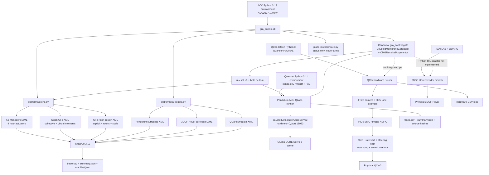
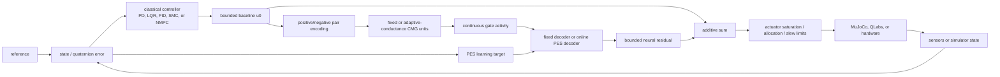

# ACC 2027 execution, environment, and code map

**Last verified:** 2026-08-27  
**Primary repository:** `C:\Research\papers\ACC2027_Gate_Residual_Control`

This is the authoritative starting point for running the current experiments.
It separates paper-grade results, integration surrogates, QLabs virtual twins,
and physical-hardware code paths.

For a step-by-step independent replication order, acceptance checks, and the
matched neuron-family preregistration, use `docs\CMG_REPLICATION_GUIDE.md`.

## 1. Results at the current checkpoint

| Evidence tier | Platform / experiment | Metric | Classical | Fixed residual | Adaptive residual | Online PES fixed | Online PES adaptive | Honest interpretation |
|---|---|---|---:|---:|---:|---:|---:|---|
| Paper candidate | Skydio X2, MuJoCo four-rotor actuators, Hard45, 45 s | mean quaternion error | 0.294082 | 0.263890 (+10.27%) | 0.263890 (+10.27%) | 0.138007 (+53.07%) | 0.138007 (+53.07%) | Strong nominal additive-residual result; zero rotor saturation. Robustness and hold-out runs remain. |
| Paper candidate / design study | CF2 explicit four-rotor design, 1.5x thrust, Hard45, 45 s | mean quaternion error | 0.285449 | 0.266050 (+6.80%) | 0.266050 (+6.80%) | 0.132319 (+53.65%) | 0.132319 (+53.65%) | Valid controller/actuator co-design simulation; **not stock CF2 hardware**. Zero saturation, modeled T/W about 1.98. |
| Authority boundary | Stock Menagerie CF2 virtual-moment XML, Hard45 | mean quaternion error / saturation | 2.458662 / 99.88% | 2.516808 / 99.89% | 2.517485 / 99.89% | not defensible | not defensible | Stock XML actuator authority cannot execute Hard45. Use as a feasibility boundary, not a controller failure. |
| Transfer/safety | QUBE Servo 3 QLabs twin, n=3, exactly 20 s balance/trial | final-5-s alpha RMS, deg | 1.0581 +/- 0.0012 | 1.0590 +/- 0.0020 | 1.1170 +/- 0.1003 | 1.0566 +/- 0.0011 | 1.0570 +/- 0.0015 | All tails balanced; zero faults/stalls. Nominal accuracy is equivalent to LQR. Do not claim improvement. |
| Historical evidence only | Skydio legacy neural blend, external wrench, Hard45 | mean quaternion error | 0.294079 | 0.275307 (+6.38%) | not separated | 0.122051 (+58.50%) | n/a | Reproduced historical result, but it is online-adaptive **blending**, not rotor-actuator additive residual control. |
| Integration smoke only | MuJoCo pendulum, 3DOF Hover, QCar surrogates | process completion and logs | pass | pass | pass | pass | pass | Confirms shared API and logging. These are not identified virtual twins and do not support physical-performance claims. |

Authoritative numeric sources:

- `results\reports\validation_summary.md`
- `results\reports\pendulum_qlabs_matched20.md`
- `docs\RESULT_AUDIT.md`

## 2. System/code schematic



The dashed edges are future integration work. They must not be described as
completed hardware integrations.

## 3. Controller execution path



Terminology:

- `fixed/adaptive` refers to neuronal conductance.
- `online PES` refers to decoder-weight adaptation.
- `residual` preserves the baseline: `u = sat(u0 + beta*delta)`.
- `legacy blend` attenuates the baseline: `u = (1-beta)u0 + beta*u_neural`.

## 4. Environment A: ACC MuJoCo simulations

Path:

```text
C:\Research\papers\ACC2027_Gate_Residual_Control
```

One-time setup:

```powershell
Set-Location C:\Research\papers\ACC2027_Gate_Residual_Control
.\scripts\setup.ps1
```

For repeatability, call the environment's Python explicitly instead of relying
on whichever `python` is first on `PATH`:

```powershell
$acc = 'C:\Research\papers\ACC2027_Gate_Residual_Control'
$py = Join-Path $acc '.venv\Scripts\python.exe'
Set-Location $acc
& $py --version
& $py -c "import mujoco; print(mujoco.__version__)"
```

Preflight before a campaign:

```powershell
& $py -m unittest discover -s tests -v
.\scripts\smoke_all.ps1
```

Expected: four unit tests pass and six short backends complete: stock CF2,
CF2 rotor design, X2, pendulum surrogate, 3DOF Hover surrogate, and QCar
surrogate.

### X2 paper matrix

```powershell
Set-Location $acc
.\scripts\run_x2_paper_matrix.ps1 -Dt 0.0005 -Beta 0.5
```

This runs `hard45`, `full3`, `roll`, and `hardstep` for classical, fixed
residual, adaptive residual, online-PES fixed, and online-PES adaptive.

Single headline reproduction:

```powershell
& $py -m gra_control.cli simulate `
  --platform x2 --controller online-pes-adaptive `
  --mission hard45 --duration 45 --dt 0.0005 --beta 0.5 `
  --learning-rate 0.0008 --k-error 8 --k-rate 0
```

### CF2 rotor-authority design matrix

```powershell
.\scripts\run_cf2_paper_matrix.ps1 `
  -ActuatorScale 1.5 -Dt 0.0005 -Beta 0.5
```

This uses `models\cf2_rotor_design`, not the stock CF2 virtual-moment
actuators. `ActuatorScale=1.5` means 0.13125 N maximum thrust per rotor and
0.525 N total modeled thrust.

Authority sweep:

```powershell
.\scripts\run_cf2_authority_sweep.ps1 -Duration 5 -Dt 0.0005 -Beta 0.5
```

### Five-seed robustness matrix

```powershell
.\scripts\run_robustness_matrix.ps1 -Duration 45 -Dt 0.0005 -Beta 0.5
```

This is tomorrow's highest-priority simulation. It applies initial attitude,
plant disturbance torque, attitude/rate measurement noise, and five seeds to
X2 and the 1.5x CF2 rotor design. Do not replace the nominal paper number with a
robustness claim until this full-duration matrix is aggregated.

### Cross-platform MuJoCo integration surrogates

```powershell
.\scripts\run_cross_platform_surrogates.ps1 -Duration 10 -Beta 0.5
```

Use this only to verify common controller execution for pendulum, 3DOF Hover,
and QCar. Their XMLs are integration surrogates, not calibrated digital twins.

### Results and reports

Each run directory contains `trace.csv`, `summary.json`, and `manifest.json`.
Aggregate a matrix with:

```powershell
& $py .\scripts\summarize_run_tree.py <absolute-result-directory>
& $py .\scripts\build_validation_report.py
```

Generated runs are under `results\runs`; stable paper figures and tables are
under `results\reports`.

## 5. Environment B: pendulum QLabs virtual twin

Repository:

```text
C:\Research\pendulum
```

Working interpreter and PAL library on this machine:

```text
C:\Users\gandhico\AppData\Local\miniconda3\envs\hyperlif\python.exe
C:\Users\gandhico\Documents\Quanser_Academic_Resources_tmp\0_libraries\python
```

Do not use the ACC Python 3.13 environment for PAL. Use the Quanser-compatible
Python 3.11 environment explicitly:

```powershell
$qpy = 'C:\Users\gandhico\AppData\Local\miniconda3\envs\hyperlif\python.exe'
$env:QUANSER_PAL_PYTHON = 'C:\Users\gandhico\Documents\Quanser_Academic_Resources_tmp\0_libraries\python'
Set-Location C:\Research\pendulum
```

In QLabs, open and start the **QUBE Servo 3 with pendulum** scene. Then run the
safe zero-voltage diagnostic:

```powershell
$env:PYTHONPATH = $env:QUANSER_PAL_PYTHON
& $qpy .\runners\twin_diagnostic.py 3
```

Canonical single run using the exact ACC controller source:

```powershell
& $qpy .\runners\twin_acc2027_gate_residual.py `
  --controller online-pes-adaptive `
  --balance-duration 20 --max-duration 90 `
  --residual-cap-v 0.35 --label reproduction
```

Canonical repeated matrix:

```powershell
.\scripts\run_acc2027_twin_matrix.ps1 `
  -BalanceDuration 20 -MaxDuration 90 -Trials 3 `
  -ResidualCapV 0.35 -Label paper_matched20
```

Aggregate with the ACC plotting environment:

```powershell
& C:\Research\papers\ACC2027_Gate_Residual_Control\.venv\Scripts\python.exe `
  .\tools\summarize_acc2027_twin.py `
  --label paper_matched20 --output .\analysis\paper_matched20
```

This matrix is already complete for the current checkpoint. Do not spend
tomorrow rerunning nominal pendulum holds. The next meaningful pendulum study is
a reset-controlled and arm-recentered disturbance benchmark.

## 6. Environment C: QCar

### Windows software-only paths

ACC MuJoCo integration surrogate:

```powershell
Set-Location $acc
& $py -m gra_control.cli simulate `
  --platform qcar --controller online-pes-adaptive `
  --duration 20 --dt 0.001 --beta 0.2
```

Existing older shared-campaign offline benchmark:

```powershell
$qpy = 'C:\Users\gandhico\AppData\Local\miniconda3\envs\hyperlif\python.exe'
Set-Location C:\Research\qcar
& $qpy .\runners\run_offline_benchmark.py --duration 20
& $qpy .\runners\plot_results.py
```

These two simulations are different lineages. The ACC surrogate uses the
canonical `gra_control.gate`; the older QCar benchmark imports
`C:\Research\_shared\quanser_residual_campaign`.

### Physical QCar2 on the Jetson

Connect and enter the on-car project:

```bash
ssh nvidia@192.168.1.129
cd ~/Documents/Quanser/examples/sdcs/qcar2/hardware/applications/GHYN/lane__following_research
```

Tomorrow's required first run is perception only—no `--armed`:

```bash
python3 qcar2_unified_lane_control_hardware_v1.py \
  --mode perception --duration 30 --no-display
```

Verify camera frames, lane validity, lane-error sign, steering-sign convention,
and CSV creation. Then use the already validated conservative PID baseline:

```bash
python3 qcar2_unified_lane_control_hardware_v1.py \
  --mode lane --controller pid --armed --duration 10 --no-display \
  --max-throttle 0.080 --base-throttle 0.070 --min-throttle 0.050 \
  --max-steering 0.25 --steering-sign 1.0
```

Run this only after the physical steering sign is checked with the car lifted or
at safe low speed. Stop immediately if the correction direction is wrong.

The full tuned PID/SMC/NMPC and existing residual commands are in:

```text
C:\Research\qcar\runners\Qcar_Hardware_runners.md
```

The current hardware script uses classical HSV perception. The ACC temporal
contrast/SNN code at `src\gra_control\perception\qcar_snn.py` is not yet wired
into the Jetson runner. Tomorrow, integrate it first in **shadow mode**: log the
HSV lane error and SNN lane estimate side by side while leaving PID steering in
control. Only enable an SNN residual after offline log comparison and a
perception-only hardware run.

## 7. Environment D: 3DOF Hover

The only executable Python path today is the ACC MuJoCo integration surrogate:

```powershell
Set-Location $acc
& $py -m gra_control.cli simulate `
  --platform hover3dof --controller online-pes-adaptive `
  --duration 10 --dt 0.001 --beta 0.2
```

The physical/vendor assets are under:

```text
C:\Research\hover3dof\3DOF_Hover
```

They contain Quanser MATLAB/Simulink/QUARC models (`q_hover.mdl`, `s_hover.mdl`)
and courseware. There is currently no reviewed Python QLabs/HIL runner and no
canonical gate-state adapter connected to the physical system. The
`hover3dof_bridge()` code in `src\gra_control\hardware_bridges.py` only computes
four bounded voltage residuals and returns zero unless armed; it does not know
the real channel map, bias voltages, watchdog, or kill switch.

Prescriptive decision: do not attempt physical 3DOF Hover control until the
motor channel map, signs, voltage limits, hover biases, sample rate, watchdog,
and emergency stop are documented and tested in a zero-output/sensor-only
adapter.

## 8. Historical Skydio reproduction

The legacy code is preserved under:

```text
C:\Research\papers\P3_Gate_Residual\learned\code\experiments\controller_benchmarks
```

Run it only through the wrapper, which records hashes and limitations:

```powershell
Set-Location $acc
.\scripts\reproduce_legacy_skydio.ps1 `
  -Duration 45 -Dt 0.0005 `
  -Methods 'classical,fixed_gate,online_pes,eprop_anneal'
```

Do not merge this runner into the canonical actuator path. It uses external
wrench injection and neural blending and is retained as historical evidence.

## 9. Prescribed order for the next working session

1. Enter the ACC repository and run unit tests plus `smoke_all.ps1`.
2. Start `run_robustness_matrix.ps1`; it is the highest-value unfinished ACC
   experiment.
3. While it runs, review `paper\WORKING_DRAFT.md` and the stable reports.
4. Run the X2 and CF2 mission matrices if not already running/completed.
5. Do not rerun the nominal pendulum matrix; its honest conclusion is closed.
6. Move to QCar: perception-only, conservative PID baseline, then SNN shadow
   logging. Preserve the existing PID steering output while evaluating vision.
7. Leave 3DOF Hover hardware untouched until a reviewed adapter exists.

## 10. Fast status commands

```powershell
# ACC repository and all software backends
Set-Location C:\Research\papers\ACC2027_Gate_Residual_Control
.\scripts\smoke_all.ps1

# Hardware integration status; read-only, never arms
$py = '.\.venv\Scripts\python.exe'
& $py -m gra_control.cli hardware-status --platform pendulum
& $py -m gra_control.cli hardware-status --platform qcar
& $py -m gra_control.cli hardware-status --platform hover3dof

# Stable report rebuild
& $py .\scripts\build_validation_report.py
```
