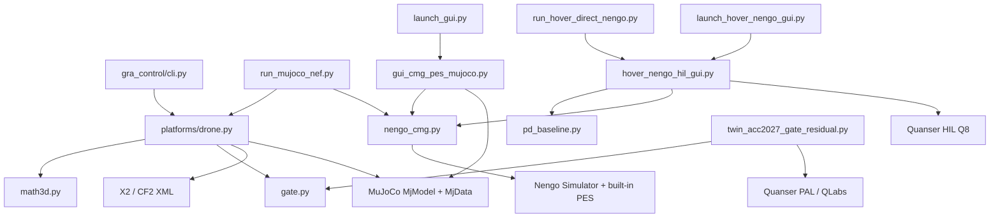

# Full Project Audit — Online PES-Adapted CMG Residual Control

**Audit date:** 2026-09-02 (America/Denver)  
**Primary repository:** `C:\Research\papers\ACC2027_Gate_Residual_Control`  
**Paper title:** *Online PES-Adapted Neuromorphic Membrane–Gate Residual Control for Actuator-Constrained UAV Quaternion Attitude Tracking*  
**Purpose:** one evidence-controlled record of the project's architecture, results, code paths, interfaces, timing, parameters, exclusions, and claim boundaries from the earliest saved experiments through the latest frozen Nengo hardware campaign.

---

## 1. Executive verdict

The project has strong ACC 2027 material, but it contains several controller generations that must remain separate.

1. **Strongest paper-ready simulation evidence:** actuator-faithful MuJoCo/Nengo quaternion-attitude control on the Skydio X2 and an explicitly declared Crazyflie 1.5× rotor-authority design. CMG–PES improves mean quaternion-angle error on all ten non-hover mission/platform cells by **17.33–60.60%**, with the largest gains on Full3, Hard45, and Yaw360.
2. **Strongest repeatable physical evidence:** Quanser 3DOF Hover Roll, direct Nengo CMG–PES, `n=3`: **2.6508 ± 1.0765%** paired mean-error improvement, with all six runs completed. The newest single Roll pair gives **+5.57% mean** but **−11.40% maximum-error change**.
3. **Newest complete physical matrix:** six matched PD/CMG profiles, 12 completed runs, 144/144 integrity checks. Results are mission-dependent: Hover +60.38% from a near-zero denominator, Roll +5.57%, Hard45 +0.55%, Hardstep +0.95%, Full3 −3.21%, and reduced-range Yaw −8.38% in mean error. This is valid evidence, including the negative rows.
4. **Full physical yaw360 is not validated.** Two baseline attempts safety-aborted at approximately ±20.127° roll. The completed profile was `reference_scale=0.3`, ending near 108°, not 360°.
5. **The large gain comes from online decoder adaptation, not adaptive conductance.** Fixed- and input-adaptive conductance CMG units are numerically indistinguishable under the present amplified-gate parameterization.
6. **CMG is not universally superior to every neuron family.** Izhikevich–PES wins some MuJoCo cells but uses substantially more normalized residual authority and decoder movement. CMG's defensible distinction is continuous non-spiking state, paired directional interpretability, consistent learning, lower authority usage, and successful physical transfer.
7. **Pendulum is a transfer/safety result, not a performance win.** Three matched QLabs trials per controller converge to the same encoder-quantized LQR limit cycle.
8. **QCar remains preliminary.** Offline lane-error abstraction and historical hardware logs exist, but canonical Nengo CMG/SNN camera-to-steering integration is not paper-grade.

---

## 2. Evidence status taxonomy

| Code | Meaning | May be used in the paper? |
|---|---|---|
| **A — approved primary** | Matched, reproducible, actuator/interface semantics audited, data and provenance present | Yes, with stated scope and sample count |
| **B — approved supporting** | Valid experiment but secondary, single-run, transfer-only, or a different controller generation | Yes, clearly labeled |
| **C — conditional/exploratory** | Technically valid but insufficiently repeated, surrogate-only, or dependent on an explicit design assumption | Only as preliminary/design evidence |
| **D — historical/superseded** | Important to architecture evolution but not the current control law or interface | History/ablation only |
| **E — not approved/excluded** | Confounded, contaminated, infeasible, safety-aborted, instrumentation fault, or claim contradicted by later evidence | No performance claim |
| **F — planned** | Code idea or platform path exists without validating evidence | Future work only |

“Approved” never means universally superior or ready for unrestricted hardware operation. It means the saved evidence supports the exact scoped statement recorded here.

---

## 3. Chronological architecture and evidence evolution

| Date/phase | Architecture at that time | Main finding | Current status |
|---|---|---|---|
| 2026-06-08 — early P3 direct-neuron study | Quaternion PD plus direct LIF/“HyperLIF”/adaptive-HyperLIF/Izhikevich output; body-torque/external-force paths and early rotor residuals | X2 Hard45 fixed gate improved modestly; LIF and Izhikevich often degraded the PD baseline; fixed and adaptive conductance were already virtually identical | **D**: valuable origin/mechanism evidence, not the final additive/actuator-faithful implementation |
| 2026-07-05 — learned-gate study | Pair-coded gate activity, trainable `3×6` decoder, online PES/e-prop, but legacy convex blend and external wrench | Skydio Hard45 q-error fell 0.294079→0.122051 (+58.50%); CF2 Hard45 learned result was even larger; imitation diverged; pure proportional PES diverged on Hardstep | **D/B**: mechanism evidence only; cannot be merged with canonical additive rotor claims |
| 2026-07-05 — conductance correction | Input-dependent conductance `g0+g1|I|` compared with fixed `g0` | Numerical identity established; decoder learning, not conductance adaptation, explains the gain | **A** mechanism conclusion |
| 2026-08-21–27 — clean ACC repository | Renamed paper-facing element **coupled membrane–gate (CMG) unit**; baseline-preserving additive residual; explicit model/actuator limits; full provenance | Removed the misleading “new LIF neuron” claim and separated blend from residual augmentation | **A** canonical architecture |
| 2026-08-27 — CF2 authority audit | Stock Menagerie virtual moments compared with inertia-derived bounds; separate four-rotor design model introduced | Historical CF2 torque floor was 61.83–104.38× inertia bound and 2000–3000× XML moment authority; stock interface was infeasible | **A** boundary result; stock >50% performance claim prohibited |
| 2026-08-27–28 — corrected UAV attitude matrix | Additive CMG residual, quaternion PD, rotor mixer, X2 and CF2 1.5× design | Hard45 +53.07% X2 and +53.65% CF2 design; five-mission matrix later showed +17–61% | **A** primary simulation evidence |
| 2026-08-27 — QUBE virtual twin | LQR plus one-channel/two-unit additive voltage residual through QLabs/PAL | All matched trials balanced; accuracy practically equivalent to LQR; earlier apparent 14% gain disappeared after matching balance exposure | **B** transfer/safety; 14% result **E** |
| 2026-08-27–28 — Hover LQR hardware | Vendor LQR motor-voltage baseline; four motor residual channels; eight CMG units; NumPy PES | Frozen n=1 results: Hard45 +1.75%, Full3 +2.47%, Yaw360 +4.79% | **B** historical physical generation; do not pool with PD/Nengo results |
| 2026-08-28 — Hover quaternion-PD hardware | MuJoCo-matched quaternion PD torque; `3×6` CMG; torque-to-F/B/L/R voltage mapping; NumPy CMG/PES | Roll reached +21.67% in a 5 s pair; Hard45/Full3 about +1.5%; yaw/hardstep exposed headroom and reference-shaping limits | **B/C** physical follow-on; mission-specific, n=1, superseded as canonical by direct-Nengo matrix |
| 2026-08-29–31 — Nengo realization | CMG implemented as a custom continuous `nengo.neurons.NeuronType`; built-in Nengo PES decoder; live MuJoCo/Nengo GUI | Isolated Nengo vs NumPy relative command error ≈1.05×10⁻⁷; closed-loop metrics match to 3–4 significant figures | **A** implementation-equivalence evidence |
| 2026-08-31 — six-DOF expansion | Outer position loop/cascade, inner quaternion attitude CMG residual, real X2 rotor mixer | X2 position/attitude gains up to +76.1%/+65.8%; CF2 cascade did not generalize | **B/C** broader simulation evidence; separate from attitude-only matrix |
| 2026-09-01 — neuron-family matrices | CMG, LIF, ALIF, Izhikevich, LIFRate with fixed/PES decoders | CMG is not the best in every cell; conventional families can learn when their activity representation is usable | **B** supplementary benchmark; no universal-neuron claim |
| 2026-09-01 — direct Nengo hardware | GUI removed from hard real-time loop; 200 Hz Q8 worker, 2 kHz inner Nengo, full neural telemetry | Six matched physical profiles completed; Roll positive and repeated; Full3 and reduced Yaw negative | **A** latest canonical hardware evidence |
| 2026-09-02 — freeze/audit | Read-only data/manifests audit | 12 canonical physical runs, 144/144 deep checks; 1,485 upstream files and 6.327 GB rehashed with zero mismatches | **A** integrity record |

---

## 4. Architecture evolution: what changed and why

```mermaid
flowchart LR
  A[Direct neuron output\nbody torque] --> B[Gate-state readout\nfixed signed decoder]
  B --> C[Legacy convex blend\n(1-beta)u0 + beta*uN]
  C --> D[Online PES decoder\nW updated every sample]
  D --> E[Canonical additive residual\nu = sat(u0 + beta*uN)]
  E --> F[Actuator-faithful mixer\nnonnegative bounded rotors]
  F --> G[Nengo CMG NeuronType\nNengo built-in PES]
  G --> H[Physical Hover adapter\nQ8, 200 Hz / neural 2 kHz]
```

| Generation | Baseline input to neural path | Neural state/readout | Output combination | Actuation | Honest interpretation |
|---|---|---|---|---|---|
| Direct-neuron P3 | PD torque/error | spikes, voltage, or gate depending on neuron | direct/blended torque | often external body wrench | Mechanism exploration |
| Fixed gate | normalized bounded baseline demand | `a=clip(10^5 r,0,1)`, `W=[I,-I]` | initially convex blend | body wrench or rotor residual | Modest effect; in legacy blend, part of gain is baseline attenuation |
| Learned legacy gate | same pair-coded CMG activity | online `W` via PES/e-prop | convex blend | external wrench | Demonstrates decoder-learning potential, not current safety architecture |
| Canonical CMG residual | saturated baseline command | pair-coded CMG, fixed/adaptive conductance | **additive** bounded residual | model-specific actuator allocation | Current paper architecture |
| Nengo CMG–PES | same equations as canonical NumPy | custom continuous CMG `NeuronType`; built-in PES | additive residual | same MuJoCo mixer or Hover voltage adapter | Current software realization |
| Hover LQR generation | four bounded motor-voltage deviations | 8 units, `4×8` decoder | additive per-motor voltage | Q8 AO0–AO3 | Valid but structurally different from UAV torque controller |
| Hover PD/Nengo generation | three quaternion-PD body torques | 6 units, `3×6` decoder | additive torque, then voltage residual cap/slew | F/B/L/R allocation and Q8 | Closest physical reproduction of MuJoCo architecture |

---

## 5. Canonical equations and variable contract

### 5.1 Rigid-body and quaternion variables

Measured attitude is the unit quaternion

\[
q=[q_0,q_x,q_y,q_z]^T,\qquad \|q\|=1,
\]

with body angular velocity \(\omega=[\omega_x,\omega_y,\omega_z]^T\). The plant equations are

\[
\dot q=\tfrac12 q\otimes[0,\omega]^T,\qquad
J\dot\omega=\tau-\omega\times(J\omega).
\]

The implementation compensates for MuJoCo model quaternion conventions by conjugating the stored body quaternion before applying the paper convention. The shortest-path error is

\[
q_e=q_d\otimes q^{-1},\qquad
e_q=\operatorname{sgn}(q_{e,0})\operatorname{vec}(q_e).
\]

The reported MuJoCo attitude metric is the geodesic quaternion angle

\[
\theta_q=2\cos^{-1}(\operatorname{clip}(|q_{e,0}|,0,1)).
\]

### 5.2 Classical quaternion PD

For diagonal inertia and \(\omega_n=[4,4,3.5]^T\), \(\zeta=0.95\),

\[
K_q=2\,\operatorname{diag}(J)\odot\omega_n^2,
\qquad
K_\omega=2\zeta\,\operatorname{diag}(J)\odot\omega_n,
\]

\[
\tau_0=\operatorname{sat}_{\tau_{\max}}
(-K_q\odot e_q-K_\omega\odot\omega).
\]

The inertia policy uses \(\tau_{\max}=\operatorname{diag}(J)\odot[12,12,10]^T\). The stock-CF2 model policy additionally limits this by its XML moment-actuator gear and control range.

### 5.3 Pair-current encoding

For `m` bounded residual channels with symmetric limits \(\ell_i>0\),

\[
u_0=\operatorname{sat}_{\ell}(u_0^{raw}),\qquad
\bar u=u_0\oslash\ell,
\]

\[
I^+=I_b\mathbf 1+I_g\max(\bar u,0),\qquad
I^-=I_b\mathbf 1+I_g\max(-\bar u,0),
\]

where \(I_b=0.75\), \(I_g=1.25\). Attitude control uses `m=3`, six ordered units `[+x,+y,+z,−x,−y,−z]`; physical Hover logs reorder the axes as `[+yaw,+pitch,+roll,−yaw,−pitch,−roll]`. The earlier LQR Hover generation uses `m=4`, eight units for `[Vf,Vb,Vl,Vr]` positive/negative branches.

### 5.4 Coupled membrane–gate dynamics

For each unit \(j\),

\[
\dot r_j=\frac{\sigma\{\alpha[v_j-(v_{th}-\gamma r_j)]\}-r_j}{\tau_r},
\]

\[
\dot v_j=-\frac{v_j-v_{rest}}{\tau}+\frac{I_j}{\tau}
-c_j(v_j-v_{reset}),
\]

\[
c_j=\left(g_0+\mathbf 1_{adapt}g_1|I_j|\right)r_j^2.
\]

Defaults: `tau=0.05 s`, `tau_r=0.005 s`, `v_rest=v_reset=0`, `v_threshold=1`, `alpha=50`, `gamma=2`, `g0=120`, `g1=30`. The gate is updated by forward Euler and clipped to `[0,1]`; the membrane is then integrated exactly over the sample under zero-order-held current:

\[
\lambda=\tau^{-1}+c,\quad
d=v_{rest}/\tau+I/\tau+c v_{reset},
\]

\[
v_{k+1}=v_ke^{-\lambda\Delta t}
+\frac d\lambda(1-e^{-\lambda\Delta t}).
\]

Both \(v\) and \(r\) are involved. The decoder reads only

\[
a=\operatorname{clip}(G r,0,1),\qquad G=10^5,
\]

but \(v\) changes the sigmoid target for \(r\), and \(r\) changes both the effective threshold and membrane conductance. This is a continuous non-spiking dynamical unit; it emits no spike events.

### 5.5 Decoder, PES, and residual

The decoder starts from

\[
W_0=\begin{bmatrix}I_m & -I_m\end{bmatrix}
\in\mathbb R^{m\times 2m},
\]

and produces

\[
s_k=\operatorname{clip}(W_k a_k,-1,1),\qquad
u_k^{neural}=s_k\odot\ell.
\]

For UAV attitude control,

\[
y_k^*=\operatorname{clip}(-k_e e_{q,k}-k_\omega^*\omega_k,-1,1),
\]

\[
\epsilon_k=y_k^*-s_k,
\]

\[
W_{k+1}=\Pi_{[-6,6]}
\left(W_k+\eta\epsilon_k a_k^T-\lambda_W W_k\right).
\]

The direct code default leak is `1e-6` per neural step. The command decoded with \(W_k\) is applied before \(W_{k+1}\) affects the next step. Nengo uses its built-in PES sign convention `error = decoded − target`; its learning-rate conversion

\[
\eta_{Nengo}=\eta_{direct}\frac{2m}{\Delta t}
\]

cancels Nengo's internal \(\Delta t/(2m)\) factor and reproduces the direct update.

The canonical architecture is

\[
u=\operatorname{sat}_{\ell}(u_0+\beta u^{neural}),\qquad
\delta u=u-u_0.
\]

The legacy, noncanonical blend was

\[
u=(1-\beta)u_0+\beta u^{neural}.
\]

These equations are not interchangeable: the blend attenuates the baseline even when the neural signal is uninformative; the additive residual retains it until final actuator saturation.

### 5.6 Fixed/adaptive terminology

| Term | What changes | What does not change |
|---|---|---|
| Fixed conductance CMG | `c=g0*r²` | Decoder may still be fixed or PES-adapted |
| Adaptive conductance CMG | `c=(g0+g1|I|)r²` | This is not PES and does not learn `W` |
| Fixed decoder | `W=W0` | CMG states still evolve continuously |
| Online PES-adapted decoder | `W` updates each sample | CMG conductance can independently be fixed or adaptive |
| “Adaptive HyperLIF” in historical filenames | Usually adaptive conductance | Must not be used as shorthand for online PES |

In the current amplified-gate regime, fixed/adaptive conductance outputs are numerically indistinguishable because the conductance difference is multiplied by \(r^2\) at the relevant operating point; online decoder adaptation is the dominant mechanism.

---

## 6. Models, interfaces, DOFs, and actuator semantics

| Platform/backend | Plant DOFs/state | Controlled output | CMG channels/units | Actual interface | Evidence meaning |
|---|---|---|---:|---|---|
| Skydio X2 MuJoCo | 6 rigid-body DOF; position + quaternion/rates | 3 body torques; vertical collective remains classical | 3 / 6 | Four named rotor thrust actuators through a `4×4` mixer | Actuator-faithful simulation |
| CF2 stock MuJoCo | 6 rigid-body DOF | 3 body torques | 3 / 6 | One collective + three abstract moment actuators with `1e-5 Nm` gear | Authority-boundary test only |
| CF2 rotor design MuJoCo | 6 rigid-body DOF | 3 body torques | 3 / 6 | Four designed rotor thrust actuators, upper range scaled 1.5× in canonical matrix | Controller/actuator co-design, not stock hardware |
| X2 6DOF cascade | position, velocity, quaternion, angular rate | outer acceleration/force + inner attitude torque | position and/or attitude residual channels by option | Real four-rotor mixer in Option A; ideal wrench in Option B | Broader simulation, separate table |
| QUBE Servo 3 QLabs | `[theta,alpha,theta_dot,alpha_dot]` | scalar motor voltage | 1 / 2 | PAL `QubeServo3(hardware=0)`, TCP/IP QLabs virtual card | Virtual twin, not hardware |
| Hover LQR physical | yaw/pitch/roll + filtered rates | four motor-equivalent voltages | 4 / 8 | Q8 AO `[Front,Back,Left,Right]`; DAC = command/3 | Historical physical generation |
| Hover PD/Nengo physical | yaw/pitch/roll → quaternion + body rates | 3 body torques | 3 / 6 | torque→minimum-norm F/B/L/R differential; common bias/floor; Q8 AO | Closest physical match to MuJoCo architecture |
| Hover emulation | three rotational coordinates/rates | same PD/CMG torque and voltage adapter | 3 / 6 | Euler rigid-body integration using realized motor torque | Software testbed, not MuJoCo/digital twin |
| QCar offline surrogate | lane/heading error abstraction | steering-like command | 1 / 2 | synthetic error dynamics, 0.35 rad steering cap | Integration smoke only |
| QCar hardware code | camera/HSV lane state, vehicle sensors | PID/SMC/NMPC steering and throttle | proposed 1 / 2 | Quanser/Jetson runner | Canonical Nengo CMG link not complete |
| QDrone2 QLabs | earlier kinematic/dynamic experiments | unresolved authoritative command channel | proposed | QLabs/QUARC material | Not closed-loop paper evidence |

### 6.1 X2 rotor allocation

For rotor thrusts \(f=[f_1,\dots,f_4]^T\),

\[
\begin{bmatrix}T&\tau_x&\tau_y&\tau_z\end{bmatrix}^T=Bf,
\quad
B=\begin{bmatrix}
1&1&1&1\\
y_1&y_2&y_3&y_4\\
-x_1&-x_2&-x_3&-x_4\\
\kappa_1&\kappa_2&\kappa_3&\kappa_4
\end{bmatrix}.
\]

The runner computes `f=B^{-1}[T,tau]`, clips each thrust to the XML range, and records saturation. Collective thrust is computed by a classical vertical loop and is not decoded by CMG.

### 6.2 Hover motor map and Q8 connection

The physical Hover channel order is `[Vf,Vb,Vl,Vr]`, mapped by

\[
\tau_{ypr}=G_v V,
\quad
G_v=\begin{bmatrix}
-k_t&-k_t&k_t&k_t\\
k_l&-k_l&0&0\\
0&0&-k_l&k_l
\end{bmatrix},
\]

with `k_t=0.0036`, `k_l=0.1188×(7.75×0.0254)`, voltage bounds 0–24 V, bias 2 V, and amplifier gain 3. The Q8 analog value is `clip(V/3,0,10)`. Encoders are Q8 channels `[0,1,2]` interpreted as `[pitch,roll,yaw]`, then returned internally as `[yaw,pitch,roll]`; yaw has a negative encoder scale. Every run tares at startup because the encoders are incremental.

The stability-priority allocator preserves pitch/roll differential first, reduces yaw only if the requested differential span cannot fit inside `[motor_floor,24]`, and chooses a feasible common-mode voltage. Requested torque, requested voltage residual, slew-limited applied voltage residual, computed voltage, and written voltage are distinct logged variables.

---

## 7. Timers, rates, numerical integration, and safety

| Path | Plant/control rate | Neural rate | Display rate | Duration/protocol | Timing/safety notes |
|---|---:|---:|---:|---|---|
| Canonical MuJoCo attitude | 2 kHz (`dt=0.0005 s`) | same 2 kHz | optional viewer throttled independently | 45 s per matched mission | MuJoCo step after command; 90,000 samples/cell |
| Nengo MuJoCo GUI | 2 kHz custom backend | 2 kHz | browser + passive viewer up to configured FPS | selected mission | GUI does not change controller timestep |
| QUBE QLabs | 500 Hz (`dt=0.002 s`) | same loop | QLabs | exactly 20 s accumulated balance, max 90 s wall | `finally`: 0 V, red LED, terminate, close |
| Hover LQR/PD NumPy | 200 Hz (`dt=0.005 s`) | 200 Hz in early NumPy runner | console/plots later | 5–30 s | Q8 zeroed before/after; per-run tare |
| Hover Nengo GUI | 200 Hz Q8 worker | 2 kHz, 10 substeps/control sample | 50 Hz immutable snapshots | ≤30 s; yaw ≤60 s | 0.5 s GUI heartbeat; 20 consecutive deadline-miss abort |
| Hover direct Nengo | 200 Hz Q8 worker | 2 kHz, 10 substeps | no GUI | canonical 8/12/30 s profiles | avoids GUI/GIL contention; dedicated heartbeat thread |

Physical guards include: explicit `--armed`, `--io q8`, `--confirm-hardware-review`; only `pd` and `nengo-pes` can be armed; 5°/sample encoder-step guard; configurable pitch/roll limits; 0–24 V motor clamp; residual magnitude and slew limits; deadline abort; and unconditional zero-output/close in `finally`.

---

## 8. Results ledger — earliest to newest

Positive percentages mean lower error than the paired baseline. Metrics are never compared across rows unless their unit and protocol match.

### 8.1 Early P3 experiments (June 2026)

| Platform/mission/protocol | Baseline | Neural result | Change | Metric | Status and reason |
|---|---:|---:|---:|---|---|
| X2 Hard45, 20 s | 0.299789 | fixed gate 0.283093 | +5.57% | mean quaternion error, rad | **D** early body-torque semantics |
| X2 Hard45, 20 s | 0.299789 | adaptive conductance 0.283093 | +5.57% | rad | **D**, establishes equivalence |
| X2 Hard45, 20 s | 0.299789 | LIF 0.353957 | −18.07% | rad | **D**, negative comparator |
| X2 Hard45, 20 s | 0.299789 | Nengo LIFRate 0.352180 | −17.47% | rad | **D**, negative comparator |
| X2 rotor residual, 20 s | 0.299789 | CMG 0.299595 | +0.06% | rad | **D**, practically neutral |
| X2 Hard45, 45 s | 0.294082 | fixed gate 0.275307 | +6.38% | rad | **D**, historical reproduction |
| X2 Full3, 20 s | 0.305617 | fixed gate 0.281009 | +8.05% | rad | **D** |
| CF2 Hard45, 45 s corrected early baseline | 0.285448 | fixed gate 0.282031 | +1.20% | rad | **D** |
| CF2 Hard45, 45 s | 0.285448 | LIF 0.320342 | −12.22% | rad | **D**, negative comparator |
| CF2 Hard45, 45 s | 0.285448 | Nengo LIFRate 0.321807 | −12.74% | rad | **D**, negative comparator |
| Early CF2 run with q-error ≈2.2135 | — | — | — | rad | **E**, historical initialization/double-hover-path failure; not a baseline |

### 8.2 Learned legacy gate (July 2026)

| Platform/mission | Classical q-error | Method q-error | Improvement | Status |
|---|---:|---:|---:|---|
| CF2 Hard45 | 0.285448 | fixed gate 0.264470 | +7.35% | **D**, legacy blend |
| CF2 Hard45 | 0.285448 | online PES 0.035549 | +87.55% | **D/B**, mechanism demonstration; external wrench/blend |
| CF2 Hard45 | 0.285448 | e-prop anneal 0.035445 | +87.58% | **D/B**, mechanism demonstration |
| CF2 Hard45 | 0.285448 | STN-PID-PES teacher 0.045254 | +84.15% | **D**, historical comparator |
| CF2 Hard45 | 0.285448 | imitation ≈2.632 | large regression | **E**, covariate-shift divergence |
| Skydio Hard45 | 0.294079 | fixed gate 0.275307 | +6.38% | **D** |
| Skydio Hard45 | 0.294079 | online PES 0.122051 | **+58.50%** | **D/B**, often-remembered “50%+” result; not canonical additive actuation |
| Skydio Hard45 | 0.294079 | e-prop 0.127526 | +56.64% | **D/B** |
| CF2 Hardstep | 0.661866 | fixed gate 0.084448 | +87.24% | **D**, legacy blend/reference behavior |
| CF2 Hardstep | 0.661866 | aggressive online PES 1.757814 | −165.59% | **E**, undamped learning diverged |

### 8.3 Corrected canonical MuJoCo attitude results (August 2026)

All rows below use shortest-path quaternion-angle mean error, 45 s, `dt=0.0005 s`, additive residual, explicit rotor allocation, `beta=0.5`, `eta=8e-4`, `k_error=8`, `k_rate=0`, and zero actuator saturation unless a summary states otherwise.

| Platform | Mission | PD baseline (rad) | Fixed CMG improvement | CMG–PES (rad) | CMG–PES improvement | Status |
|---|---|---:|---:|---:|---:|---|
| X2 | Roll | 0.050565 | +1.93% | 0.041785 | +17.36% | **A** |
| X2 | Full3 | 0.303275 | +9.74% | 0.131748 | +56.56% | **A** |
| X2 | Hard45 | 0.294082 | +10.27% | 0.138007 | +53.07% | **A** |
| X2 | Hardstep | 0.454528 | +0.46% | 0.359355 | +20.94% | **A** |
| X2 | Yaw360 | 0.075863 | +0.12% | 0.029902 | +60.58% | **A** |
| CF2 1.5× rotor design | Roll | 0.051337 | +3.31% | 0.042439 | +17.33% | **A/C** explicit design study |
| CF2 1.5× rotor design | Full3 | 0.288383 | +4.53% | 0.126476 | +56.14% | **A/C** |
| CF2 1.5× rotor design | Hard45 | 0.285449 | +6.80% | 0.132319 | +53.65% | **A/C** |
| CF2 1.5× rotor design | Hardstep | 0.426182 | +0.42% | 0.347886 | +18.37% | **A/C** |
| CF2 1.5× rotor design | Yaw360 | 0.075812 | +0.06% | 0.029870 | +60.60% | **A/C** |

Hover is omitted from percentage claims because both controllers are essentially exact at equilibrium.

### 8.4 Robustness matrix

Five seeded noisy/disturbed Hard45 trials per controller produced:

| Platform | Classical mean | PES fixed-conductance mean | PES adaptive-conductance mean | Improvement | Status |
|---|---:|---:|---:|---:|---|
| X2 | 0.510065 | 0.484446 | 0.484446 | +5.02% | **B**, seeded support; fixed/adaptive identity |
| CF2 rotor design | 0.523036 | 0.499204 | 0.499204 | +4.56% | **B/C**, design variant |

### 8.5 QUBE Servo 3 QLabs virtual twin

Metric is final-5-s upright pendulum-angle RMS in degrees, exactly 20 s accumulated balance, `n=3`.

| Controller | Mean ± SD | Change vs LQR | Residual RMS | Status |
|---|---:|---:|---:|---|
| LQR | 1.0581 ± 0.0012° | reference | 0 V | **B** |
| Fixed residual | 1.0590 ± 0.0020° | −0.08% | 0.0798 V | **B**, equivalent/slightly worse |
| Adaptive-conductance residual | 1.1170 ± 0.1003° | −5.57% | 0.0748 V | **B**, one alternate limit-cycle branch |
| PES fixed conductance | 1.0566 ± 0.0011° | +0.15% | 0.0482 V | **B**, practically equivalent |
| PES adaptive conductance | 1.0570 ± 0.0015° | +0.10% | 0.0415 V | **B**, practically equivalent |
| Earlier fixed-wall-time “≈14% improvement” | — | — | — | **E**, unequal balance exposure |

### 8.6 Physical Hover — older LQR generation

| Mission | LQR baseline | CMG–PES | Improvement | Status |
|---|---:|---:|---:|---|
| Hard45, 25 s | 12.777° | 12.553° | +1.75%; max 31.94→24.28° | **B**, n=1 |
| Full3, 25 s | 12.348° | 12.061° | +2.47% | **B**, n=1; neuron plot from later same-config run |
| Yaw360, 30 s | 6.123° | 5.830° | +4.79% | **B**, n=1 |
| Initial Set K “+38.83%” | 25 s baseline vs 30 s CMG | — | — | **E**, duration-dependent reference confound |
| Physically touched yaw run | — | — | — | **E**, contamination at ≈28.3 s |

### 8.7 Physical Hover — quaternion-PD/NumPy follow-on

| Mission | PD | PD+CMG | Improvement | Cap | Status |
|---|---:|---:|---:|---:|---|
| Roll, 5 s | 4.992° | 3.910° | +21.67% | 1.2 V/motor | **B**, valid n=1 |
| Hard45, 25 s | 22.940° | 22.582° | +1.56% | 1.2 V/motor | **B**, valid n=1 |
| Full3, 25 s | 21.706° | 21.365° | +1.57% | 1.2 V/motor | **B**, valid n=1 |
| Yaw360 | — | — | — | staged | **E/C**, no complete matched pair |
| Canonical discontinuous Hardstep | — | — | — | staged | **E**, exceeded roll boundary; shaped 0.7-scale/0.5-s version is a different mission |

### 8.8 Nengo/MuJoCo implementation and neuron-family benchmark

The primary CMG rows reproduce the table in §8.3. Across `2 platforms × 5 missions × 11 controllers = 110` cells, all expected summaries exist and all 100 neural archives passed. Nengo vs direct-NumPy mean metrics differ by approximately 2.013 ppm at worst; isolated command relative error is ≈`1.05e-7`.

The important comparator conclusion is not “other neurons fail.” In some cells Izhikevich–PES has a larger error reduction, especially Roll and Hardstep, but its mean normalized residual RMS is about 0.37 versus CMG–PES about 0.12 and it exhibits larger decoder movement. Standard LIF/ALIF activity was extremely sparse under the chosen direct-current calibration in several cells, so those zeros are representation/operating-point results, not proof that the neuron models cannot learn.

### 8.9 Six-DOF X2 expansion

| Actuation architecture | Mission | PD position / attitude | CMG position / attitude | Improvement | Status |
|---|---|---:|---:|---:|---|
| Ideal fully actuated wrench | Full6 stress | 0.1152 m / 11.920° | 0.1106 m / 6.059° | +3.96% / +49.17% | **B/C** |
| Real rotor-mixed cascade | Waypoint | 0.1680 m / 3.009° | 0.1487 m / 2.612° | +11.5% / +13.2% | **B** |
| Real rotor-mixed cascade | Circle | 0.8783 m / 13.921° | 0.3061 m / 4.441° | +65.1% / +68.1% | **B** |
| Real rotor-mixed cascade | Full6 stress | 0.9891 m / 14.646° | 0.2368 m / 5.003° | +76.1% / +65.8% | **B** |
| Tuned stock/earlier CF2 cascade | demanding missions | very accurate baseline | often negative CMG delta | regression | **B** negative result; do not conflate with 1.5× attitude design |

### 8.10 Emulated Hover family matrix

`5 missions × 11 controllers × nominal/hard-pulses = 110` cells; 99 completed. Every one of the 11 hard-pulse Yaw360 cells crossed the declared ±180° simulation-divergence boundary and is excluded from improvement claims. Nominal CMG fixed/PES improvements were Roll +10.65/+10.15%, Full3 +0.03/+0.12%, Hard45 +0.10/≈0%, Hardstep −0.08/−0.16%, and Yaw360 +1.55/+1.77%. **B/C** supplementary emulation only.

### 8.11 Latest physical direct-Nengo matrix

Metric is mean Euclidean norm of wrapped yaw/pitch/roll component errors in degrees—not the MuJoCo quaternion-angle metric. All runs use the same PD plant path and configuration within each pair. CMG: `beta=0.2`, 0.2 V per-motor residual cap, `eta=0.0002`, `k_error=2`, `k_rate=0`, 1 V/s residual slew.

| Mission | Scale/duration | PD mean/max | CMG mean/max | Mean/max change | Status |
|---|---:|---:|---:|---:|---|
| Hover | 1.0 / 8 s | 0.116° / 0.224° | 0.046° / 0.076° | +60.38% / +66.03% | **A**, but near-zero denominator; not a headline |
| Roll | 1.0 / 8 s | 5.498° / 8.150° | 5.192° / 9.079° | **+5.57% / −11.40%** | **A**, mixed mean/max |
| Full3 | 0.5 / 12 s | 11.282° / 17.005° | 11.644° / 17.075° | **−3.21% / −0.41%** | **A**, valid negative result |
| Hard45 | 0.4 / 12 s | 9.743° / 14.919° | 9.689° / 15.722° | **+0.55% / −5.38%** | **A**, mixed result |
| Hardstep | 0.35 / 12 s | 13.626° / 33.671° | 13.497° / 34.367° | **+0.95% / −2.07%** | **A**, mixed result |
| Yaw360-shaped reduced range | 0.3 / 30 s | 2.731° / 3.695° | 2.960° / 3.890° | **−8.38% / −5.27%** | **A**, valid negative; endpoint ≈108° |

Repeated Roll evidence (`n=3`) remains the strongest uncertainty-aware hardware result: PD `5.4405±0.0648°`, CMG `5.2960±0.0428°`, paired improvement `2.6508±1.0765%`; all runs completed.

Two full-scale PD Yaw360 attempts are **E safety evidence**, not completed results: 3,231 samples in a planned 30 s run and 4,905 samples in a planned 50 s run, both aborting at roll magnitude 20.127°. No full-scale CMG run is approved because baseline feasibility was not established.

### 8.12 QCar

The latest simple offline summary (`2 s`, `dt=0.01 s`) reports baseline RMS lane-error norm 0.09400 and residual 0.09018, a 4.07% numerical reduction with 4.47% more mean command. This is **C integration smoke**, not digital-twin or hardware evidence. Historical QCar2 camera/PID/SMC/NMPC hardware logs exist, including filenames mentioning gated adaptive HyperLIF, but they have not been brought under the canonical CMG/PES provenance, matched-baseline, or Nengo telemetry contract. No QCar paper result is approved.

---

## 9. Approved, conditional, and rejected result summary

| Claim/result | Decision | Exact wording boundary |
|---|---|---|
| X2 45 s attitude matrix improves 17.36–60.58% | **Approved A** | Nominal, single-run per cell, quaternion-angle mean, rotor-actuator MuJoCo |
| CF2 45 s matrix improves 17.33–60.60% | **Approved A/C** | Must say “1.5× rotor-authority design study,” never stock CF2 hardware |
| Online PES is responsible for large amplified-gate gain | **Approved A** | Fixed/adaptive conductance identity supports this parameter-regime conclusion |
| CMG works inside and outside Nengo | **Approved A** | Numerical equivalence and physical direct-Nengo execution support this |
| CMG is inherently superior to LIF/ALIF/Izhikevich | **Rejected E** | Comparator matrix disproves universal superiority |
| Skydio historical +58.5% | **Supporting D/B** | Legacy convex blend/external wrench only; do not use as canonical rotor result |
| Stock CF2 can reproduce +53–61% | **Rejected E** | Stock XML moment interface is infeasible; design study is separate |
| Pendulum improves 14% | **Rejected E** | Confounded fixed wall time; matched result is equivalent to LQR |
| Pendulum transfer is stable and bounded | **Approved B** | QLabs virtual twin, 500 Hz, all matched balance trials, not hardware |
| Hover LQR +1.75/+2.47/+4.79% | **Approved B** | Separate 8-unit motor-voltage architecture, n=1 |
| Latest direct-Nengo Hover is positive on every mission | **Rejected E** | Full3 and reduced-range Yaw regress; max error also regresses in several rows |
| Hover Roll improves | **Approved A** | Repeated n=3 mean benefit; report uncertainty and newest max-error caveat |
| Physical yaw360 completed | **Rejected E** | Only 108° scaled profile completed; two full-scale baselines aborted |
| Conventional neuron families ran on physical motors | **Rejected E** | They ran emulation and Q8 zero-output shadow only |
| QCar Nengo/SNN lane keeping is complete | **Rejected/F** | Existing baseline/perception and logs are not canonical integration evidence |

---

## 10. File and execution dependency graph



### 10.1 Authoritative files

| Role | File/path | Connects to |
|---|---|---|
| Canonical CMG equations/direct controller | `C:\Research\papers\ACC2027_Gate_Residual_Control\src\gra_control\gate.py` | All direct NumPy experiments; Pendulum; compatibility aliases |
| Quaternion math and mission references | `...\src\gra_control\math3d.py` | MuJoCo, Hover PD/Nengo, all six mission definitions |
| MuJoCo drone/model/actuator bridge | `...\src\gra_control\platforms\drone.py` | X2, stock CF2, CF2 rotor design, mixer, summaries/manifests |
| Main direct CLI | `...\src\gra_control\cli.py` | Single MuJoCo and surrogate launches |
| Nengo CMG custom neuron/PES | `...\experiments\nengo_nef_replication_2026-08-29\nengo_cmg.py` | MuJoCo Nengo runner and Hover Nengo engine |
| Nengo neuron comparators | `...\experiments\nengo_nef_replication_2026-08-29\nengo_neuron_family.py` | Supplementary LIF/ALIF/Izhikevich/LIFRate matrices |
| Nengo MuJoCo campaign runner | `...\experiments\nengo_nef_replication_2026-08-29\run_mujoco_nef.py` | 45 s matrices and full-rate neural NPZ |
| Nengo MuJoCo GUI launcher | `...\experiments\nengo_nef_replication_2026-08-29\launch_gui.py` | Browser GUI, passive MuJoCo viewer, 2 kHz backend |
| Hover plant, quaternion-PD, mixer | `C:\Research\hover3dof\pd_cmg_focused_final_round_2026-08-28\src\pd_baseline.py` | Hover NumPy and Nengo physical/emulated engines |
| Hover direct Nengo launcher | `C:\Research\hover3dof\nengo_gui_hil_2026-08-29\run_hover_direct_nengo.py` | Canonical physical matrix without GUI contention |
| Hover GUI launcher | `...\nengo_gui_hil_2026-08-29\launch_hover_nengo_gui.py` | Live browser display; same worker and output schema |
| Hover Nengo/Q8 engine | `...\nengo_gui_hil_2026-08-29\hover_nengo_hil_gui.py` | Q8 I/O, safety, 200 Hz loop, ten Nengo steps, CSV/NPZ/JSON |
| Historical Hover LQR runner | `C:\Research\hover3dof\runners\hover3dof_hil_cmg_control.py` | Eight-unit motor-voltage CMG and Q8 |
| Pendulum QLabs runner | `C:\Research\pendulum\runners\twin_acc2027_gate_residual.py` | PAL `hardware=0`, canonical direct `gate.py` |
| QCar offline runner | `C:\Research\qcar\runners\run_offline_benchmark.py` | Synthetic lane-error benchmark only |
| Paper source | `C:\Research\papers\ACC2027_Gate_Residual_Control\paper\acc2027_neuromorphic_gate_residual_draft.tex` | Figures/tables and claim text; currently requires reconciliation |

### 10.2 Canonical data roots

| Evidence | Root |
|---|---|
| Latest direct-Nengo physical matrix | `C:\Research\hover3dof\nengo_gui_hil_2026-08-29\results\DIRECT_NENGO_FINAL_2026-09-01` |
| Repeated physical Roll n=3 | `...\results\hardware_armed_roll_n3_2026-09-01` |
| Complete Hover/Nengo frozen audit | `...\results\FROZEN_AUDIT_2026-09-02` |
| MuJoCo/Nengo 110-cell family matrix | `C:\Research\papers\ACC2027_Gate_Residual_Control\experiments\nengo_nef_replication_2026-08-29\results\neuron_family_matched_45s` |
| Compiled MuJoCo/Nengo family results | `...\results\neuron_family_compiled` |
| Corrected figure source runs | `C:\Research\papers\ACC2027_Gate_Residual_Control\results\plots_data` |
| Six-DOF expansion | `C:\Research\papers\ACC2027_Gate_Residual_Control\experiments\six_dof_expansion_2026-08-31` |
| QUBE matched closure | `C:\Research\pendulum\results\acc2027_twin\*closure_matched20*` |
| QUBE aggregate | `C:\Research\pendulum\analysis\acc2027_twin_closure_matched20\aggregate.csv` |
| Hover LQR frozen figures | `C:\Research\hover3dof\results\plots\final_best` |
| Hover PD compiled ledger | `C:\Research\hover3dof\pd_cmg_focused_final_round_2026-08-28\results\compiled\campaign_pairs.csv` |
| Historical P3 source/results | `C:\Research\papers\P3_Gate_Residual` |

The user-supplied historical `D:\NMSU\_backups\...\02_Coaxial_TriRotor_Nengo` path was not mounted during this audit. Current Nengo code can be audited through the migrated C: implementation, but the original D: tree cannot be freshly hash-verified here.

---

## 11. Output and telemetry contract

| Artifact | Rate | Contents | Interpretation |
|---|---:|---|---|
| `trace.csv` MuJoCo | 2 kHz or decimated `logged_dt` | quaternion error, torque, residual, rotor commands, state, saturation; Nengo runs add neural summaries | Plant/control trace |
| `neural_trace_full_rate.npz` | 2 kHz | current, `v`, `r`, activity, native states, conductance, threshold, decoder, PES, weights, weight deltas | Full Nengo MuJoCo neural state |
| Hover `trace.csv` | 200 Hz | raw encoders, y/p/r, references, Euler component error, quaternion error, body rates, torque request/realization, motor baseline/computed/written/DAC, allocator, timing, neural snapshot | Physical control trace |
| Hover `neural_trace_2khz.npz` | 2 kHz | 28 array groups including all ten neural substeps per hardware sample | Full physical neural trace |
| `summary.json` | one/run | metrics, configuration, completion/abort, rates, paths | Machine-readable result |
| `manifest.json` | one/run | runner/model/dependency hashes and invocation arguments | Provenance |
| `neural_trace_schema.json` | one/neural run | array shapes, dtypes, channel order, semantic descriptions | Prevents variable ambiguity |

Important variable distinctions:

- `tau0`: bounded classical torque requested by the PD.
- `requested_delta_tau`: CMG decoder's bounded torque residual before Hover voltage limits.
- `requested_delta_v`: torque residual mapped into four motor-voltage differentials.
- `applied_delta_v`: magnitude- and slew-limited motor residual.
- `command_computed`: baseline plus applied residual/allocation before arm gate.
- `command_written`: what the armed logic permits to reach the amplifier.
- `*_dac_written`: Q8-level voltage after division by amplifier gain.
- `gate r`: raw continuous state, normally tiny before amplification.
- `activity a`: `clip(10^5 r,0,1)` or family-specific normalized activity.
- `decoded_raw`: `W a`; `decoded_clipped`: value actually used by PES/residual.
- `weight_delta`: one neural-step PES/leak update; `decoder_dw_hardware`: sum over ten substeps.
- `angle_err_mean_deg` on Hover: mean norm of wrapped Euler component errors.
- `qerr_mean_rad`: mean geodesic quaternion error. It is a separate metric.

---

## 12. Reproduction environments and launchers

| Task | Python/environment | Launcher |
|---|---|---|
| ACC MuJoCo/direct/Nengo | `C:\Research\papers\ACC2027_Gate_Residual_Control\.venv\Scripts\python.exe` | `python -m gra_control.cli`, `run_mujoco_nef.py`, `launch_gui.py` |
| Hover NumPy/Nengo | `C:\Research\hover3dof\.venv\Scripts\python.exe` | `hover3dof_hil_cmg_control.py`, `run_hover_direct_nengo.py`, `launch_hover_nengo_gui.py` |
| QUBE QLabs | `C:\Users\gandhico\AppData\Local\miniconda3\envs\hyperlif\python.exe` plus Quanser PAL `PYTHONPATH` | `C:\Research\pendulum\runners\twin_acc2027_gate_residual.py` |
| QCar offline | repository Python environment | `C:\Research\qcar\runners\run_offline_benchmark.py` |

Representative simulation commands:

```powershell
$accpy = 'C:\Research\papers\ACC2027_Gate_Residual_Control\.venv\Scripts\python.exe'
$nef = 'C:\Research\papers\ACC2027_Gate_Residual_Control\experiments\nengo_nef_replication_2026-08-29'

# One canonical X2 Nengo/CMG-PES mission
& $accpy "$nef\run_mujoco_nef.py" --platform x2 --controller nengo-nef-pes `
  --mission hard45 --duration 45 --dt 0.0005 --beta 0.5 `
  --learning-rate 0.0008 --k-error 8 --k-rate 0 `
  --output "$nef\results\reproduction\x2_hard45_nengo_pes"

# Live Nengo GUI + passive MuJoCo viewer
& $accpy "$nef\launch_gui.py" --platform x2 --mission hard45 `
  --duration 45 --mujoco-viewer passive --realtime
```

Physical hardware commands are intentionally not reproduced in this audit as unattended instructions. The authoritative launchers enforce the arm/confirmation gates, and the mandatory checklist is `C:\Research\hover3dof\docs\SAFETY_CHECKLIST.md`.

---

## 13. Manuscript and presentation reconciliation required

The current LaTeX draft contains internal age mismatches. Its abstract claims every Hover mission improves 1–7%, while the latest direct-Nengo matrix includes negative Full3 and reduced-range Yaw rows. A later paragraph still says physical Hover is future work even though the abstract includes hardware. Before submission:

1. choose the main physical evidence hierarchy: repeated Roll `n=3` plus the complete direct-Nengo matrix;
2. present the older LQR set separately as first-generation hardware feasibility;
3. replace “every mission improves” with mission-dependent results;
4. label reduced Yaw as 108° and full yaw360 as not validated;
5. keep the X2/CF2 design MuJoCo matrix as the primary performance table;
6. state that Izhikevich can also learn, while CMG uses lower normalized authority;
7. retain Pendulum as transfer/equivalence, not improvement;
8. omit QCar/QDrone from the result claims until matched canonical data exist.

---

## 14. Final paper evidence hierarchy

Recommended ordering in the ACC paper:

1. **Core architecture and equations:** quaternion PD + CMG + projected PES + bounded additive residual + actuator allocation.
2. **Primary simulation table:** X2 and CF2 1.5× design, five missions, CMG fixed vs CMG–PES.
3. **Mechanism:** fixed/adaptive conductance identity; fixed vs PES decoder; Nengo/direct equivalence.
4. **Focused neuron comparator:** report that Izhikevich can outperform on error but at higher residual usage; avoid a broad “CMG wins” claim.
5. **Physical result:** repeated Roll plus latest six-profile matrix, including negative and maximum-error outcomes.
6. **Boundary cases:** stock CF2 infeasibility and full physical yaw360 aborts.
7. **Supporting transfer:** QUBE QLabs equivalence and six-DOF X2 expansion if space permits.

This ordering yields a defensible paper: strong nominal actuator-aware simulation, transparent mechanism identification, verified Nengo equivalence, and honest physical evidence showing both benefit and limits.

---

## 15. Frozen audit references

- Latest comprehensive physical/data audit: `C:\Research\hover3dof\nengo_gui_hil_2026-08-29\results\FROZEN_AUDIT_2026-09-02\CONSOLIDATED_RESEARCH_AUDIT_2026-09-02.md`
- Canonical physical pair ledger: `...\FROZEN_AUDIT_2026-09-02\canonical_physical_matched_pairs.csv`
- All saved Hover/Nengo summaries: `...\FROZEN_AUDIT_2026-09-02\all_saved_run_inventory.csv`
- Upstream manifest verification: `...\FROZEN_AUDIT_2026-09-02\UPSTREAM_MANIFEST_VERIFICATION.json`
- Current result audit: `C:\Research\papers\ACC2027_Gate_Residual_Control\docs\RESULT_AUDIT.md`
- Current project status: `...\docs\PROJECT_STATUS_TABLE_2026-08-31.md`
- Pendulum closure: `C:\Research\pendulum\docs\ACC2027_PENDULUM_CLOSURE_2026-08-27.md`
- Historical learned-gate dossier: `C:\Research\papers\P3_Gate_Residual\learned\docs\full_results_dossier.md`

This document is the authoritative cross-generation interpretation. Raw summaries and manifests remain the authority for individual numeric values.
