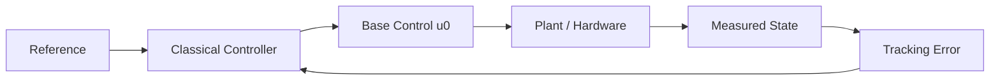
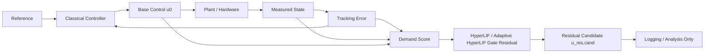
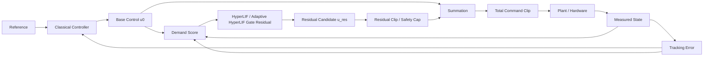
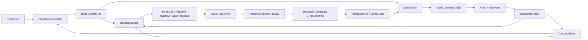
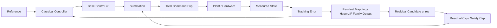

# Qube Pendulum Residual Augmentation — 60 s Hardware Results, Architectures, and Next Steps

**Date:** 2026-06-14  
**Platform:** Quanser Qube Servo 3 (pendulum balance, real hardware)  
**Experiment block:** repeated 60 s hardware trials with manual perturbations of varying intensity  

---

## 1. Executive summary

This hardware block provides the strongest real-system evidence so far for the **gate-state residual augmentation** idea.

Across **12 real-hardware 60 s trials**:
- **Gate residual, cap ±0.10 V:** 4 trials
- **Gate residual, cap ±0.20 V:** 4 trials
- **Always-on residual, cap ±0.10 V:** 4 trials

### Main takeaways

1. **All trials were safe** in the sense that all completed with **0 amplifier faults**.
2. The **gate-state residual is highly selective**: it stays almost dormant during low-demand balance and activates mainly during stronger disturbances.
3. The gate residual achieves **comparable tracking** to always-on augmentation while using **dramatically less residual activity and residual energy**.
4. **Gate ±0.10 V** is the cleanest sparse-residual condition.
5. **Gate ±0.20 V** is the strongest scaling candidate because it achieved the **lowest mean active-balance error** while remaining sparse.

The strongest current claim is therefore:

> On real Qube pendulum hardware, gate-state residual augmentation operates safely over repeated 60 s trials, remains nearly dormant in low-demand regimes, activates selectively under higher demand, and achieves comparable tracking with far lower residual activity and residual energy than always-on augmentation.

---

## 2. Main quantitative results

### 2.1 Condition-level summary

| Condition | Trials | Mean |α error| active | P95 |α error| active | High-demand mean |α error| | Applied active fraction | Low-demand applied activity | Applied residual energy |
|---|---:|---:|---:|---:|---:|---:|---:|
| Gate ±0.10 V | 4 | 0.912 ± 0.349° | 4.043 ± 2.200° | **7.712 ± 0.758°** | **4.604 ± 2.176%** | **0.040 ± 0.026%** | **1.17e-04 ± 4.11e-05** |
| Gate ±0.20 V | 4 | **0.775 ± 0.161°** | **3.252 ± 1.665°** | 8.115 ± 0.507° | **4.444 ± 2.194%** | **0.061 ± 0.048%** | 3.82e-04 ± 1.76e-04 |
| Always-on ±0.10 V | 4 | 0.901 ± 0.213° | 3.516 ± 1.764° | 8.162 ± 0.537° | 70.382 ± 13.827% | 67.666 ± 15.254% | 1.77e-03 ± 8.50e-04 |

### 2.2 Strongest comparisons

Relative to **Always-on ±0.10 V**, **Gate ±0.10 V**:
- used **93.5% less applied residual time**;
- used **93.4% less applied residual energy**;
- reduced **low-demand applied activity by 99.94%**.

Relative to **Always-on ±0.10 V**, **Gate ±0.20 V**:
- also remained sparse at only **4.44% applied residual activity**;
- achieved the **best mean active-balance error**: **0.775°**.

### 2.3 Demand-binned behavior

This is one of the most important outcomes.

#### Low-demand regime
| Condition | Low-demand time | Mean |α error| | Applied active fraction | Mean |u_residual| |
|---|---:|---:|---:|---:|
| Gate ±0.10 V | 44.86 s | 0.500° | **0.0395%** | 3.50e-06 V |
| Gate ±0.20 V | 46.29 s | **0.423°** | **0.0609%** | 4.19e-06 V |
| Always-on ±0.10 V | 44.97 s | 0.550° | **67.67%** | 1.92e-03 V |

Interpretation: during quiet balance, the gate residual is essentially **off**, while always-on keeps injecting residual almost continuously.

#### High-demand regime
| Condition | High-demand time | Mean |α error| | Applied active fraction | Mean |u_residual| |
|---|---:|---:|---:|---:|
| Gate ±0.10 V | 0.98 s | **7.712°** | 68.63% | 5.51e-03 V |
| Gate ±0.20 V | 0.73 s | 8.115° | 78.69% | **1.10e-02 V** |
| Always-on ±0.10 V | 0.76 s | 8.162° | 100.00% | 2.76e-02 V |

Interpretation: when the disturbance is stronger, the gate residual does activate and contribute, but still far more selectively than always-on.

### 2.4 Safety indicators

For all 12 trials:
- **amplifier_fault_count = 0**
- no evidence of immediate instability under the tested caps
- no safety red flags that would block staged progression to the next platform

---

## 3. Interpretation of the architectures

The experiments support a clear conceptual hierarchy.

### 3.1 Baseline classical controller
The classical controller remains the **stability anchor**.
The residual should be interpreted as an **augmentation channel**, not a replacement.

### 3.2 Gate-state residual augmentation
This is currently the most promising architecture.
It behaves like a **demand-triggered correction mechanism**:
- near balance: almost silent;
- under perturbation: activates briefly;
- after recovery: returns close to zero.

This is exactly the behavior we want if the goal is **selective neuromorphic assistance** rather than brute-force continuous residual injection.

### 3.3 Always-on residual augmentation
Always-on is useful as a **control ablation** because it tells us what happens when the residual is available all the time.
Its role is not that it is the best architecture, but that it provides a comparison showing that **gating matters**.

### 3.4 Shuffled-gate residual augmentation
This is the **timing-control ablation**.
It helps answer a deeper question:
- Is performance due to **having residual energy at all**?
- Or is it due to **activating that residual at the right time**?

This architecture remains important for causality and publication-quality argumentation, even if it is not the practical deployment choice.

# 3.5 Hardware runners

```powershell
cd C:\00_Research_\Neuromorphic_Embodied_AI\07_ServoPendulum_SNNs
.\scripts\activate_env.ps1


python .\runners\run_simulink_balance.py --hardware 1 --armed --duration 60 --voltage-limit 4.0 --require-manual-swing --manual-swing-release-deg 15 --alpha-upright-offset-deg 180 --capture-angle-deg 10 --capture-hysteresis-deg 2 --engage-confirm-samples 3 --max-engage-alpha-dot 3.0 --theta-ref-mode current_on_engage --soft-start-s 0.05 --residual-mode none --log-prefix qube3_baseline_60s

python .\runners\run_simulink_balance.py --hardware 1 --armed --duration 60 --require-manual-swing --manual-swing-release-deg 15 --alpha-upright-offset-deg 180 --capture-angle-deg 10 --capture-hysteresis-deg 2 --engage-confirm-samples 3 --max-engage-alpha-dot 3.0 --theta-ref-mode current_on_engage --soft-start-s 0.05 --residual-mode gate --residual-scale 1.0 --residual-sign 1.0 --residual-neuron adaptive_hyperlif --residual-max-voltage 0.10 --residual-log-prefix qube3_gate_cap010_60s

python .\runners\run_simulink_balance.py --hardware 1 --armed --duration 60 --require-manual-swing --manual-swing-release-deg 15 --alpha-upright-offset-deg 180 --capture-angle-deg 10 --capture-hysteresis-deg 2 --engage-confirm-samples 3 --max-engage-alpha-dot 3.0 --theta-ref-mode current_on_engage --soft-start-s 0.05 --residual-mode gate --residual-scale 1.0 --residual-sign 1.0 --residual-neuron adaptive_hyperlif --residual-max-voltage 0.20 --residual-log-prefix qube3_gate_cap020_60s

python .\runners\run_simulink_balance.py --hardware 1 --armed --duration 60 --require-manual-swing --manual-swing-release-deg 15 --alpha-upright-offset-deg 180 --capture-angle-deg 10 --capture-hysteresis-deg 2 --engage-confirm-samples 3 --max-engage-alpha-dot 3.0 --theta-ref-mode current_on_engage --soft-start-s 0.05 --residual-mode always_on --residual-scale 1.0 --residual-sign 1.0 --residual-neuron adaptive_hyperlif --residual-max-voltage 0.10 --residual-log-prefix qube3_always_on_cap010_60s

```

---

## 4. Block diagrams of the residual augmentation architectures

## 4.1 Classical baseline (no residual)



---

## 4.2 Shadow gate-state residual (analysis-only)

Residual is computed but **not applied** to the actuator.



---

## 4.3 Applied gate-state residual augmentation

This is the main proposed architecture.



---

## 4.4 Shuffled-gate residual augmentation

Same residual magnitude budget, but activation timing is deliberately misaligned.



---

## 4.5 Always-on residual augmentation

This removes selectivity and uses the residual continuously.



---

## 5. Can we move to Aero2 now?

## Short answer
**Yes — with a staged and disciplined transition.**

Based on the Qube results, I think it is justified to move tonight to **Aero2**, provided we preserve the same philosophy:
1. classical controller remains primary;
2. residual enters as a bounded augmentation;
3. we begin with **shadow analysis**, then **small applied caps**;
4. we keep strict abort / saturation / logging safeguards.

## Why the answer is yes
The Qube tests demonstrate the three things we needed most before transfer:
- **hardware safety** under repeated runs;
- **selective activation** of the residual in low/high demand regimes;
- **evidence that gating matters**, since always-on is much less selective.

The purpose of Qube was not to solve the entire robotics story, but to validate the **mechanism** on real hardware. That goal has been met well enough to justify controlled transfer.

## What not to claim yet
We should **not** yet claim universal superiority of the residual on all hardware. What we have is:
- strong proof-of-mechanism on Qube;
- good justification for transfer to more complex platforms.

---

## 6. What are the next steps on Qube itself?

Even if we move to Aero2 and QCar2 tonight, Qube still has valuable follow-up experiments.

## Immediate Qube next steps

### Q1. Repeatable perturbation protocol
Current perturbations were manual. For stronger scientific rigor, the next Qube refinement is:
- standardize perturbation timing;
- standardize perturbation magnitude as much as possible;
- re-run Gate ±0.10, Gate ±0.20, Always-on ±0.10, and optionally Shuffled-gate.

### Q2. Timing-causality block
Run **Shuffled-gate** in the 60 s protocol. This is important for a paper-quality claim that **correct timing**, not only residual energy, is beneficial.

### Q3. Cap/sign refinement
The next Qube grid should focus on:
- Gate ±0.10 V,
- Gate ±0.20 V,
- possibly Gate ±0.15 V,
- positive vs negative residual sign if physically meaningful.

### Q4. Representative plots and reporting package
Prepare the Qube section as a mini-case study:
- full overlay plots,
- demand-binned activity/error plots,
- condition summary table,
- architecture diagrams,
- code-to-math match.

---

## 7. Recommended plan for tonight: Aero2 and QCar2

## 7.1 Aero2 — recommended staged plan

Aero2 is the logical next platform because it is more dynamic than Qube but still highly structured and easier to instrument than QCar2.

### Aero2 Step A — Shadow mode first
Use the current best classical controller and log:
- tracking error,
- base command,
- demand score,
- gate state,
- residual candidate,
- saturation proximity.

Goal:
- verify the residual stays quiet in nominal operation;
- verify it activates during aggressive pitch/yaw transients, setpoint changes, or disturbances.

### Aero2 Step B — Small applied gate residual
Start with a very small cap.
Recommended philosophy:
- first cap at the smallest practical level,
- gate mode only,
- no always-on yet unless the gate mode is stable.

Goal:
- confirm no degradation of safety or stability;
- observe whether residual activity clusters around difficult transients.

### Aero2 Step C — Ablation trio
After one stable gate run:
- Gate,
- Always-on,
- Shadow or Shuffled-gate.

This lets you test whether gating is again providing selectivity and better actuation economy.

## Recommended Aero2 success criteria tonight
- no safety events;
- no obvious oscillation growth;
- residual sparse at steady state;
- residual activity rises during demanding maneuvers;
- at least one stable applied gate trial logged successfully.

---

## 7.2 QCar2 — recommended staged plan

QCar2 is more complex and risk-sensitive because steering/throttle interaction and perception uncertainty add difficulty. So the QCar residual transition should be even more staged.

### QCar2 Step A — Offline / shadow logging on a stable classical lane-following baseline
Log:
- lateral error,
- heading error,
- steering command,
- throttle command,
- demand score,
- gate state,
- residual candidate,
- saturation proximity,
- curvature or turn-demand proxy if available.

Goal:
- verify the residual activates mainly during turns, recoveries, or high-error events;
- ensure it stays minimal on straight, low-error driving.

### QCar2 Step B — Steering-only gate residual with very small cap
Do **not** start with throttle + steering together.
Apply residual first only to the **steering channel**.

Goal:
- evaluate if the residual can assist during turn entry / correction while remaining quiet on easy segments.

### QCar2 Step C — Compare gate vs always-on vs baseline
Once one steering-gate run is stable:
- Baseline,
- Gate steering residual,
- Always-on steering residual.

This should reveal whether the selectivity observed in Qube persists in mobile robotics.

## Recommended QCar2 success criteria tonight
- safe lane following preserved;
- no growing oscillation or unstable steering;
- residual stays sparse on straight segments;
- residual activity increases on turns or larger corrections;
- one clean logged run in shadow, and if safe, one clean small-cap applied gate run.

---

## 8. Practical recommendation: what to do tonight

If time is limited tonight, I recommend the following order:

### Priority order
1. **Aero2 shadow**
2. **Aero2 applied gate (small cap)**
3. **QCar2 shadow**
4. **QCar2 applied steering-only gate (small cap)**

### Why this order
- Aero2 is the best next transfer test of the residual mechanism.
- QCar2 is valuable, but it has more interacting variables and thus higher experimental complexity.
- If Aero2 works tonight, that significantly strengthens the case for the architecture.
- If QCar2 shadow logging works tonight, that is already a meaningful win.

---

## 9. Recommended decisions right now

## Decision on Qube
- **Keep Gate ±0.10 V** as the clean sparse benchmark.
- **Keep Gate ±0.20 V** as the stronger-performance scaling benchmark.
- **Keep Always-on ±0.10 V** as the main ablation baseline.
- Add **Shuffled-gate** when you want the strongest causal timing claim.

## Decision on platform transition
- **Yes, proceed to Aero2 tonight.**
- **Yes, proceed to QCar2 tonight, but start in shadow mode and steering-only residual logic.**

---

## 10. Files supporting this report

Primary files:
- `qube_60s_residual_hardware_report.md`
- `qube_60s_condition_summary.csv`
- `qube_60s_per_trial_metrics.csv`
- `qube_60s_demand_binned_summary.csv`
- `figures/qube_60s_condition_summary_panel.png`
- `figures/qube_60s_error_vs_residual_activity.png`
- `figures/qube_60s_demand_binned_activity.png`
- `figures/qube_60s_demand_binned_error.png`

---

## 11. Final conclusion

The Qube pendulum experiments have moved the residual augmentation idea from a promising concept to a **credible real-hardware mechanism**.

The main scientific message is not merely that a residual was added, but that:
- the residual can be **selective**,
- the selectivity is **demand-linked**,
- the mechanism is **safe enough to stage-transfer**,
- and the gate-state strategy is much more meaningful than indiscriminate always-on augmentation.

That is enough to justify the next step:

> **Transfer the gate-state residual augmentation to Aero2 tonight, then to QCar2 with shadow-first and steering-first discipline.**

