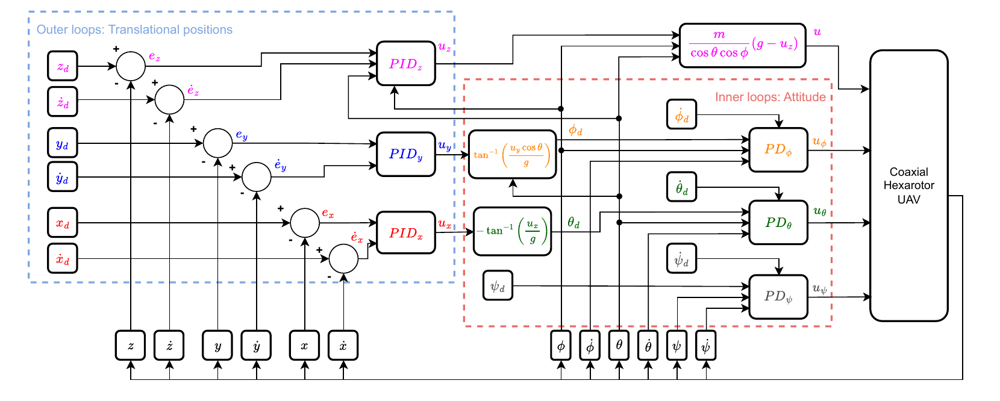
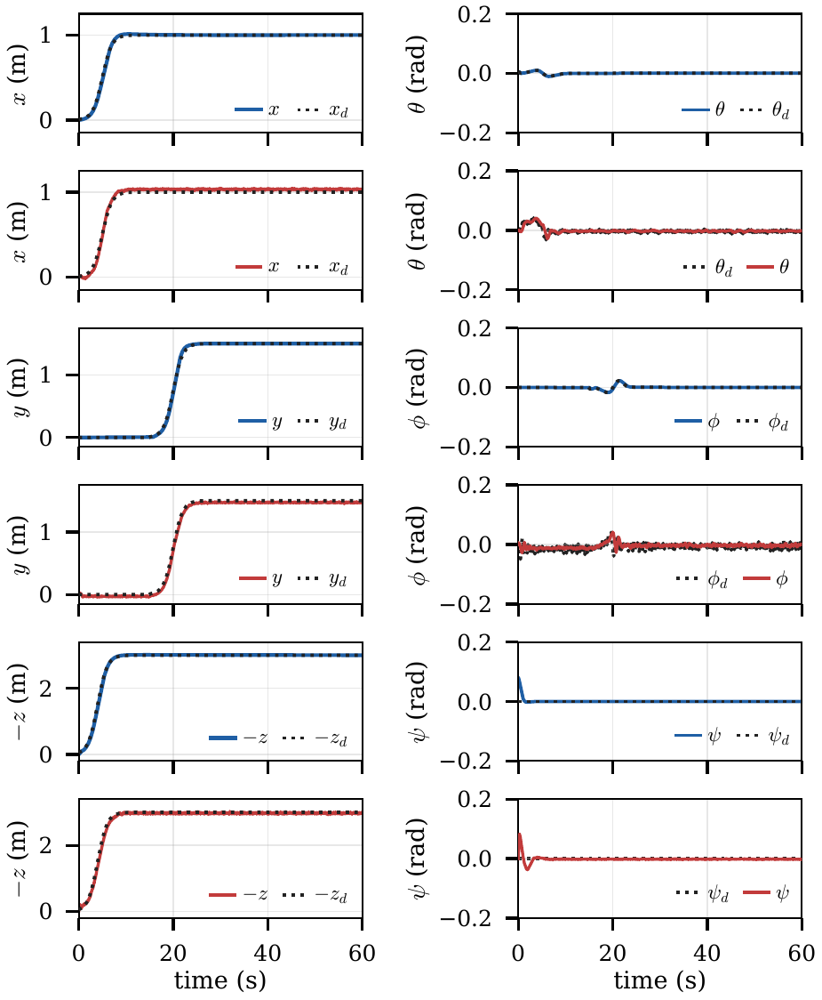

# MATLAB/Simulink classical controller

Classical cascade flight controller for the coaxial hexarotor, built in **MATLAB/Simulink R2025a**. It is the conventional baseline against which the spiking (NEF/Nengo) controller in [`../Nengo`](../Nengo) is compared in the paper.

- **Outer loops (translational):** PID on x, y and z.
- **Inner loops (attitude):** PD on θ, φ and ψ.
- **Plant:** the reduced hexarotor model (m = 1 kg, g = 9.81 m/s²), integrated with RK4 at 1 kHz.



## Folder structure

| Folder | Content |
| --- | --- |
| `models/` | `Quadri_Victor_combination_PID_R2025a.slx` (compact model) and `Quadri_Victor_combination_PID_R2025a_CE.slx` (channel-explicit version: one labelled subsystem per control channel, matching the diagram) |
| `params/` | `victor_pid_params.m`: gains, limits, mission and simulation settings |
| `build/` | Scripts that regenerate the models from `params/` and the MATLAB Function code in `build/matlab_function_code/` |
| `run/` | Simulation, verification and paper-configuration scripts |
| `diagrams/` | draw.io source and PDF of the cascade scheme |
| `results/` | Tracking metrics and figures |

## Workflow

1. **Parameters.** Edit gains, limits and the mission in `params/victor_pid_params.m`.
2. **Build (optional).** The models are included. To regenerate them:
   ```matlab
   addpath('params','build','run')
   build_victor_pid_R2025a                    % compact models
   build_victor_pid_R2025a_channel_explicit   % *_CE models
   compare_CE_vs_monolithic                   % checks both versions give identical signals
   ```
3. **Simulate** in MATLAB/Simulink:
   ```matlab
   run('run/run_Quadri_Victor_combination_PID_R2025a.m')
   ```
   The logged reference, state, command and error signals are saved to `results/`.
4. **Paper configuration.** The paper uses PD attitude loops (k_iθ = k_iφ = k_iψ = 0) and an initial yaw of 0.08 rad, so that the classical and spiking missions start under the same conditions. `run/sim_quad_pd_inner.py` is an operation-by-operation Python port of the Simulink model. Its states match the Simulink run to numerical round-off (below 10⁻¹¹), and it writes the paper run:
   ```bash
   python run/sim_quad_pd_inner.py
   ```
   To obtain the same run directly in Simulink, set `ki_theta = ki_phi = ki_psi = 0` and the yaw initial state (`quad_x0(7) = 0.08`) in `params/victor_pid_params.m`. Both models then give the results below.
5. **Comparison.** The exported classical signals are compared with the spiking controller in `../Nengo`.

## Mission

A 60 s trajectory built from sigmoid references with slope k = 1:

- **z_d:** climb to 3 m, centred at t = 4 s.
- **x_d:** move 1 m, centred at t = 5 s.
- **y_d:** move 1.5 m, starting after a 15 s delay (centred at t = 20 s).
- **ψ_d:** 0.

## Gains

| Loop | k_p | k_d | k_i |
| --- | --- | --- | --- |
| x | 1.6 | 5.0 | 0.08 |
| y | 3.0 | 2.0 | 0.10 |
| z | 40 | 5.0 | 2.0 |
| θ | 120 | 8.0 | — |
| φ | 40 | 8.0 | — |
| ψ | 7.0 | 4.0 | — |

Tilt commands are limited to ±35°, and total thrust to [0, 3mg].

## Results

Tracking performance over the 60 s mission ([`results/classical_tracking_metrics.csv`](results/classical_tracking_metrics.csv)), next to the spiking controller reported in the paper:

| Variable | RMSE classical | RMSE SNN | ISE classical | ISE SNN |
| --- | --- | --- | --- | --- |
| x [m] | 0.008 | 0.032 | 3.95 × 10⁻³ | 0.0627 |
| y [m] | 0.013 | 0.033 | 0.0101 | 0.0660 |
| z [m] | 0.019 | 0.048 | 0.0213 | 0.1367 |
| θ [rad] | 3.26 × 10⁻⁴ | 0.005 | 6.38 × 10⁻⁶ | 1.71 × 10⁻³ |
| φ [rad] | 9.73 × 10⁻⁴ | 0.012 | 5.68 × 10⁻⁵ | 8.67 × 10⁻³ |
| ψ [rad] | 6.62 × 10⁻³ | 0.009 | 2.63 × 10⁻³ | 4.61 × 10⁻³ |

The spiking controller closely follows the classical one: the correlation between the two is 0.9993 (x), 0.9998 (y) and 0.9992 (−z).



## Requirements

- MATLAB R2025a with Simulink.
- Python 3 with NumPy, only for `run/sim_quad_pd_inner.py`.
