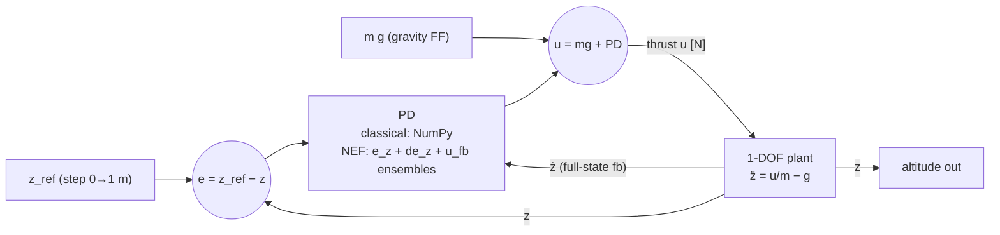

# Exp 01 — 1-DOF Altitude (Phase 2, pedagogical anchor)

**Goal:** validate the whole benchmark pipeline (plant → classical → NEF → CSV/plots/metrics)
on the simplest possible plant before scaling up, and establish the first real
classical-vs-neuromorphic comparison.

## Plant & controller

Plant (z-up), `m = 0.9 kg`, `g = 9.81`:
$$\ddot z = u/m - g, \qquad u\in[0,\;2.5\,mg].$$

Control law (classical *and* NEF compute the same thing):
$$u = mg + K_p\,(z_{ref}-z) + K_d\,(\dot z_{ref}-\dot z),\quad K_p=8.0,\;K_d=4.0$$
$$\Rightarrow\;\omega_n=\sqrt{K_p/m}=2.98\ \text{rad/s},\quad \zeta=\tfrac{K_d}{2\sqrt{K_p m}}=0.745.$$

The NEF controller computes the **PD feedback in spiking neurons** (`e_z`, `de_z`, `u_fb`
ensembles); the constant `mg` gravity term is a feed-forward node. Velocity comes from the
plant state (full-state feedback), avoiding Victor's noisy dual-synapse differentiator.

## Control loop



## Results (real runs — `dt=1 ms`, `T=10 s`, step 1 m at `t=1 s`)

| controller | rise [s] | settling [s] | overshoot [%] | SSE [m] | IAE | ISE | ctrl energy ∫u² | effort beyond hover | sat [%] | RMSE [m] |
|---|---|---|---|---|---|---|---|---|---|---|
| classical PD | 0.761 | 1.936 | 2.98 | −0.0000 | 0.545 | 0.361 | 708.6 | 7.19 | 0 | 0.200 |
| **NEF (LIF spiking)** | 0.723 | 1.796 | 2.67 | 0.0002 | 0.544 | 0.372 | 709.1 | 7.87 | 0 | 0.203 |
| NEF (rate) | 0.716 | 1.766 | 2.60 | 0.0028 | 0.559 | 0.374 | 709.3 | 8.03 | 0 | 0.204 |

*(All stable; all settle within ±2 cm. Numbers regenerate via the runner; source of truth =
`results/summaries/exp01_metrics.csv`.)*

**Sanity check vs. control theory** (validates the pipeline): analytic 2nd-order predictions for
the classical loop are overshoot ≈ 3.0 %, rise ≈ 0.74 s, settling ≈ 1.8 s — matching the
simulated 2.98 % / 0.76 s / 1.94 s.

## Interpretation (NEF vs classical)

The spiking-LIF NEF controller **reproduces the classical PD altitude response to within a few
percent on every metric** (overshoot 2.67 % vs 2.98 %, settling 1.80 s vs 1.94 s, steady-state
error < 1 mm), at a modest **~9 % higher control effort beyond hover** (7.87 vs 7.19) caused by
spike ripple on the thrust command. In short: on this channel the neuromorphic controller is
**performance-equivalent** to the classical baseline — the expected and honest result — which
validates the NEF Principle-3 mapping and the metric/CSV/plot pipeline before we scale to the
coupled, underactuated multi-axis system. (The small rise-time *speedup* of the NEF runs is
within loop-tuning/synaptic-filter noise, not a genuine improvement; we do not claim NEF beats
classical.)

## Interactive GUI & block diagrams

- **Nengo GUI:** `src/gui/gui_exp01_altitude_nef.py` (+ `.cfg`) — watch the controller live
  (z vs reference, thrust, neural error/PD signals). Launch with
  `.venv/Scripts/nengo.exe src/gui/gui_exp01_altitude_nef.py`.
- **Block diagrams:** `paper/diagrams/blockdiagram_classical_altitude.pdf` (Simulink-style)
  and `blockdiagram_nef_altitude.pdf` (neural). See [`docs/block_diagrams.md`](../../docs/block_diagrams.md)
  (incl. the honest note on Simulink/MATLAB availability).

## Run

```bash
../../.venv/Scripts/python.exe run_exp01.py
```
Outputs → `results/csv/exp01_altitude_timeseries.csv`, `results/summaries/exp01_metrics.csv`,
`results/plots/exp01_altitude.png`.
